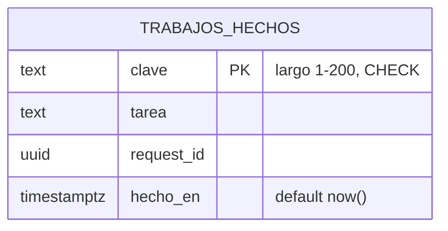
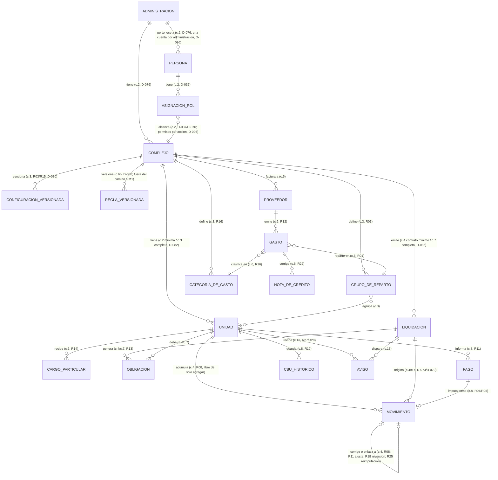

# Modelo de Datos

> A partir de las migraciones reales en `backend/` (Alembic) y de las decisiones de modelado ya
> tomadas (D-040, D-046, D-076, D-082, D-086). No se inventa un modelo de datos que el código todavía
> no construyó: hoy sólo existe la tabla técnica del cambio 1c (`trabajos_hechos`); el resto (desde la
> administración hasta el libro de movimientos) es planificado, por cambio, y así queda marcado en
> cada sección.

## Dominios

Los mismos módulos de `02_descripcion_general.md` §Arquitectura general (D-021, D-040):

- **complejos**: administraciones, edificios (y más adelante barrios), unidades, grupos de reparto,
  categorías de gasto, configuración versionada (intereses, fondo de reserva, estado de unidad).
- **acceso**: identidades, roles, asignaciones por edificio, auditoría de acciones sensibles.
- **gastos**: proveedores, gastos (con sus cuatro estados, D-075), cargos particulares, notas de
  crédito, ingresos del consorcio (propuesta, R38).
- **liquidacion**: liquidaciones (borrador, emitida, distribuida, anulada), obligaciones, controles
  antes de emitir.
- **cuenta_corriente**: el libro de movimientos de sólo agregar (R08), imputaciones, saldo inicial.
- **pagos**: pagos informados, confirmados, rechazados y revertidos; CBU histórico; reimputaciones.
- **avisos**: eventos de aviso por email, con su clave de idempotencia.
- **politicas**: reglas del motor por edificio, versionadas (D-066).
- **compartido**: tipo `Dinero` (R07, D-046), sesión de base con el tenant fijado (D-076), auditoría.

## ERD (Entity Relationship Diagram)

Dos diagramas: lo que existe hoy en las migraciones reales (`backend/migraciones/versions/`) y lo
planificado por cambio, a partir de `12_fichas_de_changes.md` y de las reglas y decisiones citadas en
"Entidades". Ningún atributo del diagrama planificado es definitivo: donde la ficha de un cambio dice
"a decidir en el design", el diagrama lo marca así en vez de inventar columnas.

### Existente hoy

Es la única tabla del sistema al 14/10/2026 (`backend/migraciones/versions/0002_trabajos_hechos.py`).
La migración `0001_inicial.py` está vacía a propósito (`upgrade()`/`downgrade()` no hacen nada: el
cambio 1a sólo deja el mecanismo de Alembic andando, D-040). `trabajos_hechos` no tiene relaciones de
dominio: es la tabla técnica de idempotencia del worker (D3 del cambio 1c, D-090), no pertenece a
ningún módulo de `proptech_core`.

### Planificado, por cambio (ningún atributo es definitivo salvo el citado)

Notas de lectura (ninguna reemplaza el *design* del cambio que corresponde):

- **`c.N`** es el número del cambio que construye esa entidad (`12_fichas_de_changes.md`). `UNIDAD`,
  por ejemplo, nace mínima en el cambio 2 (D-082: "para probar el acceso, este cambio crea lo mínimo de
  administración, complejo, unidad, persona y asignación por rol") y el cambio 3 la completa con tipo,
  coeficiente y estado.
- El **modelo de tablas concreto del libro de movimientos** (`MOVIMIENTO`, `OBLIGACION`) queda
  explícitamente **a decidir en el design del cambio 4** (`motor-de-cuenta-corriente`): su ficha dice
  "Decidir en el design: el modelo de tablas del libro; cómo se bloquea la cuenta durante una
  imputación; el desempate determinista del mayor resto". El diagrama de arriba muestra sólo las
  relaciones que las reglas ya exigen (un movimiento por unidad, de sólo agregar, que referencia la
  liquidación que lo originó y, cuando corresponde, a otro movimiento que corrige o enlaza), nunca una
  estructura de columnas que todavía no se diseñó.
- **`LIQUIDACION`** es, hasta el cambio 7, sólo su "contrato mínimo" (identificador, período, edificio y
  estado, D-086), para que cada movimiento pueda referenciarla desde el cambio 4; el cambio 7 agrega
  preliquidación, controles (R34) y la máquina de estados de distribución (D-073, D-074).
- **`REGLA_VERSIONADA`** (el motor de GoRules ZEN, cambio 6b) queda **fuera del camino crítico a M1**:
  ninguna regla vigente pasa todavía por el motor (D-089); hasta el 6b no hay puerto: intereses, fondo
  de reserva y cargo por estado son menús de configuración (D-080), y R14 y R37, si se validan, van
  como código simple (D-089).
- No se dibujan entidades propias para R23 (monto atípico), R25 (reimputación), R29 (condonación), R31
  (gestión judicial) ni R35-R41: según su propia regla son **movimientos o marcas sobre las entidades de
  arriba**, no tablas nuevas · ver el detalle en "Entidades".

## Entidades

Formato por entidad: **qué es** (dominio y cambio que la construye) · **atributos conocidos** (sólo
los que una regla, decisión o archivo de código ya fija; el resto es "a decidir en el design") ·
**relaciones** · **constraints** · **índices**. Las columnas exactas de SQLAlchemy/Alembic de las
entidades planificadas no existen todavía: lo que sigue es lo que el *design* de cada cambio tiene que
respetar, no una migración adelantada.

### Existe hoy

#### `trabajos_hechos` · existe (migración `0002`, cambio 1c)

- **Qué es**: tabla técnica de idempotencia del worker (D3): registra la clave de idempotencia dentro
  de la misma transacción que el efecto del trabajo, para que una ejecución repetida con la misma clave
  no lo vuelva a aplicar.
- **Atributos** (`backend/migraciones/versions/0002_trabajos_hechos.py`):
  - `clave` · `TEXT`, **clave primaria**.
  - `tarea` · `TEXT`, `NOT NULL`.
  - `request_id` · `UUID`, `NOT NULL` (el número de seguimiento de punta a punta, `11_glosario.md`).
  - `hecho_en` · `TIMESTAMP(timezone=True)`, `NOT NULL`, `server_default now()`.
- **Relaciones**: ninguna con el dominio de negocio; es una tabla aparte de `proptech_core`.
- **Constraints**: `CHECK (length(clave) BETWEEN 1 AND 200)` (`ck_trabajos_hechos_largo_clave`).
- **Índices**: sólo el implícito de la clave primaria (`clave`); no hay índices adicionales.
- **Sin `administracion_id`**: nace sin tenant (D-091, deuda del 1c). El cambio 2 decide si lo agrega
  según el plan de Row-Level Security que esa ficha describe, y cómo el worker lo fija por tarea.

### Planificado, dominio `complejos`

#### `administracion` · planificada (cambio 2, D-076)

- **Qué es**: el tenant. El cliente que paga PropTech (`11_glosario.md`).
- **Atributos conocidos**: identificador; el resto, a decidir en el design del cambio 2.
- **Relaciones**: tiene muchos `complejo`; tiene muchas `persona` (una cuenta por administración, no
  una identidad global con membresías; D-096 resolvió P18. Una persona con unidades en dos
  administraciones tiene dos cuentas, una en cada una, con el mismo email permitido en ambas).
- **Constraints**: ninguna consulta, archivo, caché o proceso puede devolver datos de otra
  administración (R10); el valor sale siempre de la identidad autenticada, nunca de un parámetro del
  cliente.
- **Índices**: a decidir en el design.

#### `complejo` · planificada (cambio 2 mínima / cambio 3 completa, D-040, D-076)

- **Qué es**: la comunidad que se administra (hoy sólo "edificio"; "barrio" queda preparado en el
  diseño, D-027). Es un **alcance** dentro de la administración (D-076), no el tenant.
- **Atributos conocidos**: `nombre`, `localidad` (`Edificio` en `semilla.py`: `_Texto`, no vacío).
- **Relaciones**: pertenece a una `administracion`; tiene muchas `unidad`, `grupo_de_reparto`,
  `categoria_de_gasto`; tiene una `configuracion_versionada` vigente (y el historial de las anteriores).
- **Constraints**: toda tabla con datos de un complejo lleva, según el plan de RLS de la ficha del
  cambio 2, `administracion_id NOT NULL`, con RLS activada y forzada.
- **Índices**: a decidir en el design.

#### `unidad` · planificada (cambio 2 mínima / cambio 3 completa, D-082)

- **Qué es**: la unidad funcional sobre la que se liquida (departamento, cochera, baulera, local;
  `11_glosario.md`).
- **Atributos conocidos**, tomados de `Unidad` en `backend/src/proptech_core/compartido/semilla.py`
  (el modelo que ya valida el edificio de ejemplo, no todavía una tabla):
  - `identificador` · texto no vacío, único **dentro de su complejo** (no globalmente).
  - `tipo` · debe existir en `tipos_de_unidad` de `parametros.yaml` del complejo (D-042).
  - `piso` · texto no vacío.
  - `coeficiente` · `Decimal` positivo, hasta 6 decimales (`^\d(\.\d{1,6})?$`, `semilla.py`).
  - `superficie_m2` · `Dinero` positivo (reusa el tipo `Dinero`, no una columna de superficie distinta).
  - `estado` · campo presente en el modelo pero **desactivado por default en edificios** (D-030); se
    construye con barrios (v1.2, D-089).
- **Relaciones**: pertenece a un `complejo`; participa de uno o varios `grupo_de_reparto`; tiene muchas
  `obligacion`, `movimiento`, `cargo_particular`, `pago`, `cbu_historico`.
- **Constraints**: la suma de los coeficientes de un complejo (o de un grupo con coeficientes propios,
  si P24 lo decide así) tiene que dar 1 con una tolerancia de ±0,0001 (R01, D-082); `semilla.py` hoy
  exige la suma **exacta** a 1 sobre el total del edificio (más estricto que R01, es validación de la
  semilla, no de la regla general).
- **Índices**: a decidir en el design; candidato natural, único compuesto `(administracion_id,
  complejo_id, identificador)`.

#### `grupo_de_reparto` · planificada (cambio 3, R01)

- **Atributos conocidos**, de `GrupoDeReparto` en `parametros.py` y `grupos_de_reparto` en
  `parametros.yaml`: `clave` (`^[a-z][a-z0-9_]{0,39}$`), `nombre` (hasta 80 caracteres), `metodo`
  (`coeficiente | superficie | partes_iguales`), `alcance` (`todas_las_unidades | a_elegir`),
  `descripcion` opcional.
- **Relaciones**: pertenece a un `complejo`; agrupa muchas `unidad`; cada `gasto` se asigna a uno.
- **Constraints**: el grupo `generales` es obligatorio, con `metodo=coeficiente` y
  `alcance=todas_las_unidades` (`_validar_cruzadas` en `parametros.py`); claves no repetidas dentro del
  complejo.
- **Pendiente (P24)**: si un grupo parcial (Ascensor, Cocheras) lleva coeficientes propios por unidad o
  renormaliza los generales entre sus unidades; el edificio de ejemplo hoy no lo resuelve (ver "Seed
  data inicial").

#### `categoria_de_gasto` · planificada (cambio 3, R16, D-041)

- **Atributos conocidos**, de `CategoriaDeGasto` en `parametros.py`: `clave`, `nombre`. Arranca con las
  nueve categorías de `parametros.yaml` (ver "Seed data inicial"); el administrador puede crear,
  renombrar, ordenar y desactivar las suyas (una categoría con gastos no se borra, se desactiva).
- **Relaciones**: pertenece a un `complejo`; clasifica muchos `gasto`.
- **Constraints**: claves no repetidas dentro del complejo.

#### `configuracion_versionada` · planificada (cambio 3, D-080, D-010, D-031)

- **Qué es**: la configuración de intereses (R03) y fondo de reserva (R15) de un complejo, **versionada
  con fecha y autor**; cada liquidación guarda la versión con la que se calculó (historia, no se pisa).
- **Atributos conocidos**, de `Intereses`/`FondoDeReserva` en `parametros.py`: `tasa_mensual` (0 a 10%,
  `_PATRON_PORCENTAJE`), `dias_de_gracia` (entero 0 a 31), `forma_de_calculo`
  (`proporcional_por_dia | mes_entero`), `porcentaje` del fondo (0 a 100%). Son **menús cerrados**, no
  fórmula libre (D-010).
- **Relaciones**: pertenece a un `complejo`; cada `liquidacion` referencia la versión vigente al emitir.
- **Pendiente**: si el edificio piloto usa el esquema de doble vencimiento (R26, P19) en vez de este
  menú; cómo se guarda exactamente el historial de versiones, a decidir en el design del cambio 3.

#### `regla_versionada` · planificada (cambio 6b, D-066; fuera del camino a M1)

- **Qué es**: una regla propia de un edificio en formato JDM, ejecutada por GoRules ZEN detrás del
  puerto de políticas, versionada con fecha y autor (D-066, `13_motor_de_reglas.md`).
- **No se construye para ninguna regla vigente del MVP** (D-089): entra sólo cuando R14 o R37 se validen
  y migren desde su versión de código simple de los cambios 7/8.

### Planificado, dominio `acceso`

#### `persona` · planificada (cambio 2, D-009, D-076)

- **Qué es**: la identidad autenticada (administrador titular, colaborador, vecino o consejo).
- **Relaciones**: pertenece a una `administracion` (D-096 resolvió P18: una cuenta por administración,
  no varias); tiene muchas `asignacion_rol`.
- **Constraints**: el login del personal y el acceso del vecino (Clerk o enlace mágico, u otra
  alternativa) se deciden en el design del cambio 2 (D-039, D-043).

#### `asignacion_rol` · planificada (cambio 2, D-037)

- **Qué es**: la relación entre una `persona`, un rol (titular, colaborador, consejo, vecino) y su
  alcance (todos los complejos de la administración, los asignados, el suyo, o sus unidades).
- **Constraints**: el colaborador sólo ve los edificios que le asignan, con nivel "ver" o "editar"
  (D-037); fuera de alcance responde 404.
- **Permisos por acción (P23, resuelta en D-096)**: qué rol puede emitir, distribuir, anular una
  liquidación, confirmar y revertir pagos, condonar, dar de baja una deuda y aceptar alertas; ver la
  matriz completa en D-096. P20 sigue abierta: si por encima de un monto el titular necesita además
  la aprobación del consejo antes de condonar. Ver `03_actores_y_roles.md` §RBAC.

### Planificado, dominio `gastos`

#### `proveedor` · planificada (cambio 6)

- **Relaciones**: factura a un `complejo`; emite muchos `gasto`.
- **Constraints**: identificado por CUIT (R12); el historial de montos por proveedor alimenta el
  control de monto atípico (R23, propuesta, umbral pendiente P21).

#### `gasto` · planificada (cambio 6, manual; cambio 14, lectura por QR/IA)

- **Atributos conocidos** (de R12, R13, R16, D-075): proveedor, concepto, categoría (obligatoria),
  grupo de reparto, período, importe (`Dinero`), tipo ordinario/extraordinario (default ordinario), y
  del comprobante: CUIT emisor, punto de venta, tipo y número de comprobante.
- **Estados** (D-075, máquina de cuatro pasos): **borrador** → **sin IA** o **en revisión** (lectura
  automática) → **aprobado**. Sólo el aprobado entra en el cálculo.
- **Relaciones**: pertenece a un `complejo`, un `proveedor`, un `grupo_de_reparto`, una
  `categoria_de_gasto`; puede tener una o más `nota_de_credito`.
- **Constraints**: `cuit + punto_de_venta + tipo_comprobante + numero` no se repite dentro del complejo
  (R12, clave completa aclarada por D-079/D-081 para no confundir una factura con su nota de crédito).
- **Índices**: candidato único compuesto sobre esa misma clave, a decidir en el design del cambio 6.

#### `nota_de_credito` · planificada (cambio 6, R22, D-061)

- **Constraints**: asociada a la `gasto` (factura) que corrige; su monto no puede superar el de esa
  factura; se descuenta del gasto antes de prorratear, en el período en que se carga (nunca reabre una
  liquidación ya emitida, D-082).

#### `cargo_particular` · planificada (cambio 6, R14, D-025)

- **Atributos conocidos**: unidad, concepto, importe, período, motivo; o importado en lote desde Excel.
- **Relaciones**: pertenece a una `unidad`.
- **Constraints**: en borrador no entra en la liquidación; un **cargo recurrente del reglamento**
  (propuesta, R14) lo genera la regla del motor cada período, no se carga a mano.

#### `ingreso` · planificada, propuesta (cambio 6/7, R38, pendiente P15)

- **Qué resuelve**: lo que cobra el consorcio (cochera común, terraza, SUM) y baja el total a repartir
  de su grupo. **Entra sólo si se valida** (D-071); hasta entonces, un ingreso mayor que los gastos
  ordinarios del grupo frena la emisión con un control duro (R34, D-080).

### Planificado, dominio `liquidacion`

#### `liquidacion` · planificada (cambio 4, contrato mínimo / cambio 7, completa; D-086, R17)

- **Atributos conocidos del contrato mínimo** (D-086, cambio 4): identificador, período, edificio y
  **estado**.
- **Estados** (R17, D-073, D-074): `borrador` → `emitida` → `distribuida`; `anulada` sólo desde
  `emitida`. Guardados **como una secuencia de eventos de sólo agregar** (emitida, distribuida,
  anulada), coherente con el libro de la cuenta corriente (R08), no como una columna que se sobrescribe.
- **Relaciones**: pertenece a un `complejo`; genera muchas `obligacion` y `movimiento` (cada movimiento
  referencia la emisión que lo generó, D-086).
- **Constraints**: no se puede emitir dos veces el mismo período salvo que la anterior esté anulada
  (R17); los períodos se liquidan en orden (R40, propuesta); anular excluye **todo** lo que generó esa
  emisión (obligaciones, intereses, ajustes de interés que compensaban ese interés) sin borrar ningún
  movimiento (D-073, D-079, D-085).

#### `obligacion` · planificada (cambio 4)

- **Atributos conocidos**: unidad, período, capital desglosado en ordinario y extraordinario (R13); su
  residual se calcula siempre desde sus imputaciones, nunca desde una marca de "pagada" (R05).
- **Relaciones**: pertenece a una `unidad` y a la `liquidacion` que la generó.

### Planificado, dominio `cuenta_corriente`

#### `movimiento` · planificada (cambio 4, R08; modelo de tablas a decidir en el design de ese cambio)

- **Qué es**: el libro de **sólo agregar**: ningún movimiento se edita ni se borra; un error se corrige
  con un movimiento nuevo con motivo y responsable (R08).
- **Tipos conocidos por las reglas** (no son valores de enum ya decididos, son los que el modelo tiene
  que poder representar): débito (emisión, interés) y crédito (pago, corrección, condonación R29,
  ajuste de interés R11, bonificación R37, reimputación R25, baja de deuda R41).
- **Relaciones**: pertenece a una `unidad`; referencia la `liquidacion` (emisión) que lo generó; algunos
  tipos referencian a otro movimiento (una corrección a lo que corrige, R08; un ajuste de interés al
  interés que compensa y a la emisión que lo cobró, D-082/D-085; una reversión al pago que revierte,
  R18; una reimputación a los dos movimientos enlazados, R25).
- **Constraints**: `UPDATE`/`DELETE` sobre un movimiento tiene que rebotar **también por SQL directo**
  (R08, tests mínimos); ninguna obligación queda con residual negativo (R05); el saldo de una unidad
  excluye todo movimiento de una emisión anulada (D-073, D-079).
- **Índices**: a decidir en el design del cambio 4, junto con el resto del modelo de tablas del libro.

#### Moroso crítico · **no es una entidad**, es una función (D-074)

R20 se calcula siempre desde las imputaciones del libro, nunca desde una marca guardada: "no hay nada
que reevaluar". Se construye como consulta pura en el cambio 4; el cambio 10a sólo la lista, exporta y
presenta.

### Planificado, dominio `pagos`

#### `pago` · planificada (cambio 8, R11)

- **Atributos conocidos**: unidad (o varias, si se reparte entre las de una misma persona), comprobante,
  monto, fecha de la transferencia (distinta de la de confirmación), número de operación.
- **Estados**: informado → confirmado (o rechazado, con motivo) → revertido (R18, si el banco lo
  devuelve después de confirmado).
- **Constraints**: `numero_operacion` no se repite dentro del complejo (R11); un pago informado no
  afecta la deuda hasta que el administrador lo confirma.

#### `cbu_historico` · planificada (cambio 8, R19)

- **Qué es**: el CBU de origen de cada pago confirmado, cuando se conoce; alimenta una sugerencia de
  confianza alta al cruzar el extracto (cambio 9), nunca asigna sola (principio 3 de Alberto).
- **Relaciones**: pertenece a una `unidad`.

### Planificado, dominio `avisos`

#### `aviso` · planificada (cambio 13, propuesta R27/R28)

- **Atributos conocidos**: unidad, liquidación que lo dispara, tipo (vencimiento o mora), clave de
  idempotencia (un aviso por evento, no se duplica).
- **Pendiente**: si el edificio corre el aviso antes de confirmar un pago informado sin confirmar aún
  (P41).

## Seed data inicial

Dos archivos ya validados (cambio 1b, D-053), con sus lectores propios
(`backend/src/proptech_core/compartido/parametros.py` y `semilla.py`), que todavía **no se insertan en
la base** (no hay tablas de edificio hasta el cambio 3, que es quien carga la semilla).

### `config/parametros.yaml` · los valores con que arranca cada edificio nuevo (D-042)

Validado por `Parametros` (`parametros.py`): `version: 1` (`Literal[1]`).

- **Intereses**: `tasa_mensual: "3.00"` (3% mensual), `dias_de_gracia: 0`,
  `forma_de_calculo: proporcional_por_dia`.
- **Fondo de reserva**: `porcentaje: "0.00"` (sin fondo por default).
- **Categorías de gasto** (9): encargado, seguridad, limpieza, ascensor, mantenimiento, servicios,
  seguros, administración, varios.
- **Grupos de reparto** (4): `generales` (coeficiente, todas las unidades, obligatorio con esa forma),
  `ascensor` (coeficiente, a elegir, "sin planta baja ni locales"), `cocheras` (coeficiente, a elegir),
  `servicios_centrales` (coeficiente, a elegir).
- **Tipos de unidad** (4): departamento, cochera, baulera, local.
- **Estados de unidad**: `habilitados: false` (D-030, desactivado en edificios; se construye con
  barrios, D-089); trae igual los cuatro estados (baldío, en obra, habitado, desocupado) con factor
  100% y cargo fijo $0 cada uno, por si se habilitan.

### `config/semilla/edificio-ejemplo.yaml` · el edificio de ejemplo (cambio 1b, D-053)

Validado por `Semilla` (`semilla.py`) contra los parámetros de arriba: `version: 1`.

- **Edificio**: "Edificio Ejemplo", Mendoza.
- **13 unidades**: 1 local (PB, coeficiente 0,08), 8 departamentos (1A a 4B, coeficiente 0,10 cada
  uno), 3 cocheras (C1-C3, coeficiente 0,03 cada una), 1 baulera (B1, coeficiente 0,03). La suma da
  exactamente 1 (`0.08 + 8×0.10 + 3×0.03 + 0.03 = 1.00`), como exige `semilla.py` (suma **exacta**, más
  estricta que la tolerancia ±0,0001 de R01 para la regla general).
- **Grupos**: `generales: todas`; `ascensor` con los 8 departamentos; `cocheras` con las 3 cocheras.
- **Hallazgo sin pregunta abierta propia** (la ficha del cambio 3 ya lo anota como tarea, no como
  P-nueva): los grupos parciales `ascensor` y `cocheras` de este archivo **no tienen un coeficiente
  propio por unidad** · reusan el coeficiente general de cada unidad, que no suma 1 dentro del grupo
  parcial (los 8 coeficientes de `ascensor` suman 0,80, no 1). La ficha del cambio 3 dice explícitamente
  "alinear el validador de la semilla con R01 (tolerancia de ±0,0001) y con la respuesta a P24": la
  pregunta que lo cubre es **P24** (coeficientes de grupos parciales), ya abierta en
  `10_preguntas_abiertas.md`. No se inventa acá una solución.
- **Estado de migración**: el campo todavía no existe en este archivo (lo suma el cambio 3, D-083); hoy
  la semilla no declara "sin saldos previos" porque ese campo no se construyó aún.
