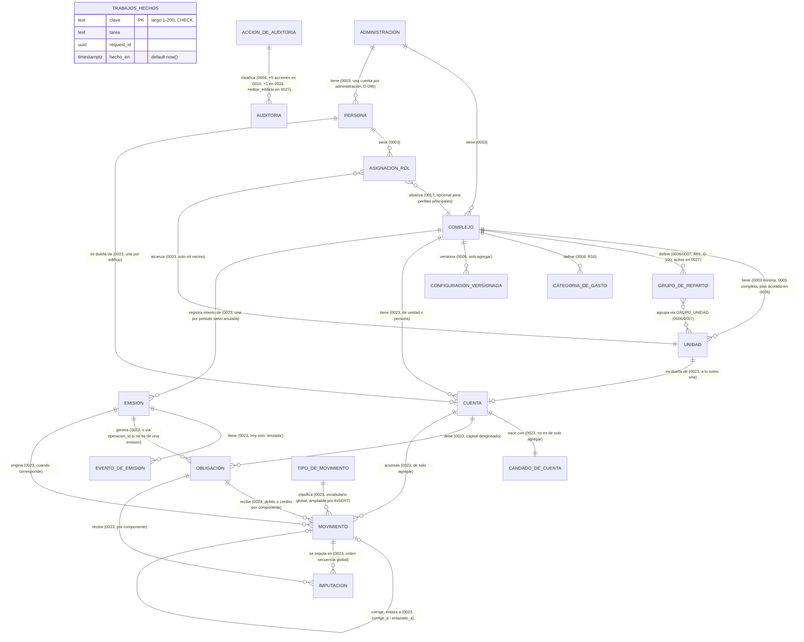
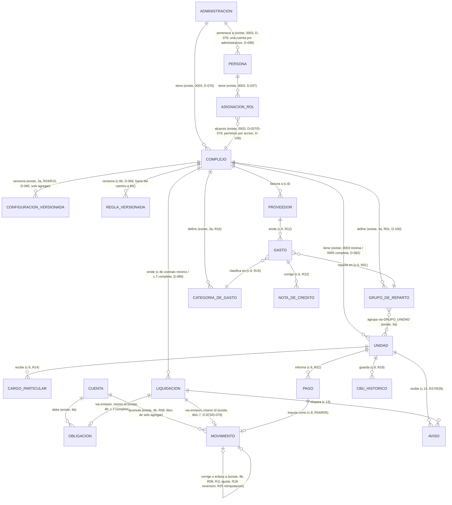

# Modelo de Datos

> A partir de las migraciones reales en `backend/` (Alembic) y de las decisiones de modelado ya
> tomadas (D-040, D-046, D-076, D-082, D-086, D-098, D-100, D-103, D-104, D-106). Desde el cierre del 2a
> (15/10/2026) ya existen, además de `trabajos_hechos`: `administracion`, `complejo` (mínimo), `unidad`
> (mínima), `persona`, `asignacion_rol`, `accion_de_auditoria` y `auditoria` (migraciones
> `0003_acceso_minimo` y `0004_auditoria`). Desde el cierre del 3a (19/10/2026, migraciones `0005` a
> `0016`) `complejo` y `unidad` quedan completos y se suman `grupo_de_reparto`, `grupo_unidad`,
> `categoria_de_gasto` y `configuracion_versionada` (de sólo agregar), más cinco acciones nuevas de
> `accion_de_auditoria`. El 2.2a (20/10/2026, `0017` y `0018`) reemplaza los roles y
> agrega vínculos e índices únicos en `asignacion_rol`. El 2b `login-y-usuarios` (22/10/2026,
> migraciones `0019` y `0020`) agrega `persona.clerk_usuario_id` (único por administración) y la tabla
> `invitacion`, más ocho eventos de acceso al vocabulario de `accion_de_auditoria`. El 4a
> `cimientos-del-libro` (26/10/2026, migraciones `0021` y `0022`) suma a `configuracion_versionada` la
> columna del umbral de R30 y un trigger de bloqueo por sentencia, la pasa al rol de arranque como
> `auditoria`, y agrega siete eventos del padrón al vocabulario. El **4b `libro-de-movimientos`**
> (27/10/2026, migraciones `0023` y `0024`) construye el libro: ocho tablas nuevas en
> `cuenta_corriente` (`cuenta`, `emision`, `evento_de_emision`, `obligacion`, `movimiento`,
> `imputacion`, de sólo agregar; `candado_de_cuenta`, que no lo es; `tipo_de_movimiento`, vocabulario
> global), y suma `corregir_movimiento` al vocabulario de auditoría. El 3c `pulido-de-la-configuracion`
> (27/10/2026, migraciones `0025` a `0027`, después de las del 4b) suma a `complejo` la ubicación (ids
> de Georef, nullable, "los tres o ninguno") y `calle_y_numero`, pasa `localidad` a nullable y
> derivada; suma `pisos` y `subsuelos` al edificio y acota `unidad.piso` a un vocabulario cerrado
> (nullable); suma `grupo_de_reparto.activo` y el evento `editar_edificio` al vocabulario de
> auditoría. El resto (4c, 4d, 5 a 15) sigue siendo planificado, por cambio, y así queda marcado en
> cada sección.

## Dominios

Los mismos módulos de `02_descripcion_general.md` §Arquitectura general (D-021, D-040):

- **complejos**: administraciones, edificios (y más adelante barrios), unidades, grupos de reparto,
  categorías de gasto, configuración versionada (intereses, fondo de reserva, estado de unidad).
- **acceso**: identidades, roles, asignaciones por edificio, auditoría de acciones sensibles.
- **gastos**: proveedores, gastos (con sus cuatro estados, D-075), cargos particulares, notas de
  crédito, ingresos del consorcio (propuesta, R38).
- **liquidacion**: liquidaciones (borrador, emitida, distribuida, anulada) y los controles antes de
  emitir. **Las obligaciones ya no son de este dominio**: viven en `cuenta_corriente` desde el 4b
  (son parte del libro, de sólo agregar, D-120).
- **cuenta_corriente**: el libro de movimientos de sólo agregar (R08), construido en el 4b: cuentas,
  emisiones, obligaciones, movimientos e imputaciones, más el candado por cuenta y el vocabulario
  global de tipos de movimiento. El 4c agrega el saldo inicial y el moroso crítico como funciones
  sobre este libro.
- **pagos**: pagos informados, confirmados, rechazados y revertidos; CBU histórico; reimputaciones.
- **avisos**: eventos de aviso por email, con su clave de idempotencia.
- **politicas**: reglas del motor por edificio, versionadas (D-066).
- **compartido**: tipo `Dinero` (R07, D-046), sesión de base con el tenant fijado (D-076), auditoría.

## ERD (Entity Relationship Diagram)

Dos diagramas: lo que existe hoy en las migraciones reales (`backend/migraciones/versions/`) y lo
planificado por cambio, a partir de `12_fichas_de_changes.md` y de las reglas y decisiones citadas en
"Entidades". Ningún atributo del diagrama planificado es definitivo: donde la ficha de un cambio dice
"a decidir en el design", el diagrama lo marca así en vez de inventar columnas.

### Existente hoy

`complejo` suma en `0025`-`0026` (3c) la ubicación (`provincia_id`/`departamento_id`/`localidad_id`/
`calle_y_numero`, nullable) y `pisos`/`subsuelos` (nullable); no se dibujan como entidades aparte
porque son columnas del mismo `complejo`, no tablas nuevas.

La única tabla del sistema hasta el 14/10/2026 era `trabajos_hechos`
(`backend/migraciones/versions/0002_trabajos_hechos.py`). La migración `0001_inicial.py` está vacía a
propósito (`upgrade()`/`downgrade()` no hacen nada: el cambio 1a sólo deja el mecanismo de Alembic
andando, D-040). `trabajos_hechos` no tiene relaciones de dominio: es la tabla técnica de idempotencia
del worker (D3 del cambio 1c, D-090), no pertenece a ningún módulo de `proptech_core`. Desde el cierre
del 2a (15/10/2026, migraciones `0003_acceso_minimo` y `0004_auditoria`) existen además las siete
tablas del candado, detalladas en "Entidades" más abajo. Desde el cierre del 3a (19/10/2026,
migraciones `0005` a `0016`) `complejo` y `unidad` quedan completos y se suman `grupo_de_reparto`,
`grupo_unidad`, `categoria_de_gasto` y `configuracion_versionada`. Desde el cierre del 4b (27/10/2026,
migraciones `0023_libro_de_movimientos` y `0024_corregir_movimiento`) existen además las ocho tablas
del libro y su candado, detalladas en "Entidades hoy, dominio `cuenta_corriente`" más abajo.

### Planificado, por cambio (ningún atributo es definitivo salvo el citado)

Notas de lectura (ninguna reemplaza el *design* del cambio que corresponde):

- **`c.N`** es el número del cambio que construye esa entidad (`12_fichas_de_changes.md`). `UNIDAD`,
  por ejemplo, nació mínima en el cambio 2a (D-082: "para probar el acceso, este cambio crea lo mínimo
  de administración, complejo, unidad, persona y asignación por rol") y el 3a (`0005`) ya la completó
  con tipo, coeficiente, superficie y estado.
- **El modelo de tablas del libro de movimientos ya no es "a decidir": está construido desde el 4b**
  (migración `0023`, D1 del design archivado). `UNIDAD` y `LIQUIDACION` **no tienen una FK directa**
  hacia `MOVIMIENTO` ni `OBLIGACION`: la unidad (o la persona) llega a través de `CUENTA`, y la
  liquidación a través de `EMISION`, que comparte id con ella (ver "Entidades hoy, dominio
  `cuenta_corriente`"). El detalle completo de las ocho tablas, sus columnas, FK y únicos vive en esa
  sección; este diagrama simplificado no reemplaza esa lista.
- **`LIQUIDACION`** es, hasta el cambio 7, sólo su "contrato mínimo" (identificador, período, edificio y
  estado, D-086) — y ese identificador **es el mismo id que `emision`** del libro, construido en el 4b;
  el cambio 7 agrega preliquidación, controles (R34) y la máquina de estados de distribución (D-073,
  D-074).
- **`REGLA_VERSIONADA`** (el motor de GoRules ZEN, cambio 6b) queda **fuera del camino crítico a M1**:
  ninguna regla vigente pasa todavía por el motor (D-089); hasta el 6b no hay puerto: intereses, fondo
  de reserva y cargo por estado son menús de configuración (D-080), y R14 y R37, si se validan, van
  como código simple (D-089).
- No se dibujan entidades propias para R23 (monto atípico), R25 (reimputación), R29 (condonación), R31
  (gestión judicial) ni R35-R41: según su propia regla son **movimientos o marcas sobre las entidades de
  arriba**, no tablas nuevas · ver el detalle en "Entidades".

## Entidades

Formato por entidad: **qué es** (dominio y cambio que la construye) · **atributos conocidos** (sólo
los que una regla, decisión o archivo de código ya fija; el resto es "a decidir en el design") ·
**relaciones** · **constraints** · **índices**. Las columnas exactas de SQLAlchemy/Alembic de las
entidades planificadas no existen todavía: lo que sigue es lo que el *design* de cada cambio tiene que
respetar, no una migración adelantada.

### Existe hoy

#### `trabajos_hechos` · existe (migración `0002`, cambio 1c)

- **Qué es**: tabla técnica de idempotencia del worker (D3): registra la clave de idempotencia dentro
  de la misma transacción que el efecto del trabajo, para que una ejecución repetida con la misma clave
  no lo vuelva a aplicar.
- **Atributos** (`backend/migraciones/versions/0002_trabajos_hechos.py`):
  - `clave` · `TEXT`, **clave primaria**.
  - `tarea` · `TEXT`, `NOT NULL`.
  - `request_id` · `UUID`, `NOT NULL` (el número de seguimiento de punta a punta, `11_glosario.md`).
  - `hecho_en` · `TIMESTAMP(timezone=True)`, `NOT NULL`, `server_default now()`.
- **Relaciones**: ninguna con el dominio de negocio; es una tabla aparte de `proptech_core`.
- **Constraints**: `CHECK (length(clave) BETWEEN 1 AND 200)` (`ck_trabajos_hechos_largo_clave`).
- **Índices**: sólo el implícito de la clave primaria (`clave`); no hay índices adicionales.
- **Sin `administracion_id`**: nace sin tenant (D-091, deuda del 1c). El cambio 2 decide si lo agrega
  según el plan de Row-Level Security que esa ficha describe, y cómo el worker lo fija por tarea.

### Existe hoy, dominio `complejos` y `acceso` (migraciones `0003` y `0004`, cambio 2a)

**Convención de aislamiento (B2, D5, cambio 2a)**: toda tabla que cuelga de una `administracion` lleva
`administracion_id NOT NULL` con Row-Level Security activada y forzada (`aislar_por_administracion`,
`migraciones/ayudas_rls.py`); toda tabla que además cuelga de un `complejo` (un edificio) lleva
`complejo_id NOT NULL` con una **FK compuesta** `(administracion_id, complejo_id)` hacia `complejo`, no
una FK simple a `complejo.id`: así ninguna fila puede apuntar a un complejo de otra administración.
`unidad` y `asignacion_rol` ya siguen esta convención; toda tabla nueva que cuelgue de un edificio
(cambio 3 en adelante) la repite.

#### `administracion` · existe (migración `0003`, cambio 2a, D-076)

- **Qué es**: el tenant. El cliente que paga PropTech (`11_glosario.md`).
- **Atributos** (`backend/migraciones/versions/0003_acceso_minimo.py`):
  - `id` · `UUID`, clave primaria, `server_default gen_random_uuid()`.
  - `nombre` · `TEXT`, `NOT NULL`.
- **Relaciones**: tiene muchos `complejo`; tiene muchas `persona` (una cuenta por administración, no
  una identidad global con membresías; D-096 resolvió P18. Una persona con unidades en dos
  administraciones tiene dos cuentas, una en cada una, con el mismo email permitido en ambas).
- **Constraints**: RLS forzada por su propio `id` (es el único tenant que se aísla por sí mismo, no por
  `administracion_id`); ninguna consulta, archivo, caché o proceso puede devolver datos de otra
  administración (R10), y el valor sale siempre de la identidad autenticada, nunca de un parámetro del
  cliente.
- **Índices**: sólo el implícito de la clave primaria; el resto queda a decidir en el design del 2b.

#### `complejo` · completo (migración `0003`, cambio 2a; completada en `0005`, cambio 3a; ubicación y
pisos en `0025`/`0026`, cambio 3c, D-040, D-076, D-128)

- **Qué es**: la comunidad que se administra (hoy sólo "edificio"; "barrio" queda preparado en el
  diseño, D-027). Es un **alcance** dentro de la administración (D-076), no el tenant.
- **Atributos** (`0003_acceso_minimo.py` + `0005_edificio_y_unidad.py` + `0025_ubicacion_del_edificio.py`
  + `0026_pisos_del_edificio_y_la_unidad.py`): `id` · `UUID` PK; `administracion_id` · `UUID NOT NULL`;
  `nombre` · `TEXT NOT NULL`; `localidad` · `TEXT`, **nullable desde `0025`** y **derivada** (D2 del 3c:
  la aplicación la escribe con el nombre de la localidad de Georef cada vez que guarda la ubicación; la
  API dejó de aceptarla como entrada); `provincia_id`/`departamento_id`/`localidad_id` · `TEXT`,
  nullable, los tres ids del archivo de Georef (`config/georef/`, CC BY 4.0, D-128); `calle_y_numero` ·
  `TEXT`, nullable, texto libre sin validar contra el dataset de calles (P62); `pisos` · `INTEGER`,
  nullable, 1 a 60; `subsuelos` · `INTEGER`, nullable, 0 a 5 (P64); `estado_migracion` · `TEXT NOT NULL`,
  `CHECK IN ('pendiente', 'confirmada', 'sin_saldos_previos')`, default `'pendiente'` (R09, D-083).
- **Relaciones**: pertenece a una `administracion` (FK simple); tiene muchas `unidad`,
  `grupo_de_reparto`, `categoria_de_gasto` y `configuracion_versionada` (todas con FK compuesta hacia
  `complejo`, convención del 2a). Ya tenía `unidad` y `asignacion_rol` colgando desde el 2a.
- **Constraints**: `administracion_id NOT NULL`, RLS forzada; `UNIQUE (administracion_id, id)` para que
  las tablas que cuelgan de él puedan usarlo como destino de una FK compuesta; `ck_complejo_nombre_no_vacio`
  (`0016`, `nombre <> ''`). `localidad` queda fuera de ese `CHECK` desde siempre (decisión de Juani,
  dueño 3b; no cambia con el 3c). `ck_complejo_ubicacion_completa_o_vacia` (`0025`): los tres ids de
  Georef son los tres `NULL` o los tres no `NULL` — nunca una ubicación a medias; `calle_y_numero` no
  lleva `CHECK` de largo en la base, igual que `localidad` (el máximo de 200 vive en la aplicación,
  H-8). `ck_complejo_pisos` y `ck_complejo_subsuelos` (`0026`): rango o `NULL`. Los edificios ya
  cargados antes del 3c quedan con las seis columnas nuevas en `NULL` (sin backfill, D3/DBA-1): la
  puesta a punto los pide como paso nuevo, antes de los seis que ya tenía el 3b.
- **Índices**: ninguno además de los implícitos de las claves.
- **Editar el edificio** (`PATCH /complejos/{id}`, D5 del 3c): reusa el permiso `CONFIGURAR_PADRON`
  (no toca la matriz D-106); audita con el evento `editar_edificio` (sumado a `accion_de_auditoria` en
  `0027`), guardando sólo los **nombres** de los campos cambiados, nunca otros valores (D-016).

#### `unidad` · completa (migración `0003`, cambio 2a; completada en `0005`, cambio 3a, D-082; `piso`
acotado al vocabulario en `0026`, cambio 3c, D3, D-128)

- **Qué es**: la unidad funcional sobre la que se liquida (departamento, cochera, baulera, local;
  `11_glosario.md`).
- **Atributos** (`0003_acceso_minimo.py` + `0005_edificio_y_unidad.py` +
  `0026_pisos_del_edificio_y_la_unidad.py`): `id` · `UUID` PK; `administracion_id` · `UUID NOT NULL`;
  `complejo_id` · `UUID NOT NULL` (FK compuesta `(administracion_id, complejo_id)` → `complejo`);
  `identificador` · `TEXT NOT NULL` (renombrada desde `nombre`, única dentro de su complejo); `tipo` ·
  `TEXT NOT NULL`, `CHECK IN` los valores de `TIPOS_DE_UNIDAD_VALIDOS`, default `'departamento'`;
  `piso` · `TEXT`, **nullable desde `0026`** (`NULL` = "sin completar", nunca un dato inventado, E5);
  `coeficiente` · `NUMERIC(7,6) NOT NULL`, `CHECK > 0 AND <= 1`; `superficie_m2` · `NUMERIC(10,2) NOT
  NULL`, `CHECK > 0`; `estado` · `TEXT`, opcional (desactivado por default en edificios, D-030; se
  construye con barrios, v1.2, D-089).
- **Vocabulario de `piso`** (D3 del 3c): `^(SS[1-5]|PB|[1-9]|[1-5][0-9]|60)$`
  (`ck_unidad_piso`) — `SS1` a `SS<complejo.subsuelos>`, `PB` (siempre) y `1` a `<complejo.pisos>`; el
  rango 1-60 queda escrito en el propio patrón. La base sólo valida la **forma**; que el piso esté
  dentro del vocabulario **de su edificio concreto** (que depende de `complejo.pisos`/`subsuelos`, una
  lectura cruzada) lo valida la aplicación. Los cuatro tipos de unidad (D-029) eligen de la misma
  lista: no hay restricción de vocabulario por tipo (la semilla ya pone cocheras y baulera en el
  subsuelo). Migración `0026`: mapea `'PB'`→`'PB'`, `'SS'`→`'SS1'`, un entero de 1 a 60 ya escrito como
  tal → ese mismo texto; todo lo demás (vacío, `'pb'`, `'1°'`, `'Entrepiso'`, `' 2 '`) → `NULL`.
- **Relaciones**: pertenece a un `complejo` (FK compuesta); participa de uno o varios `grupo_de_reparto`
  vía `grupo_unidad`; tendrá muchas `obligacion`, `movimiento`, `cargo_particular`, `pago`,
  `cbu_historico` (cambio 4 en adelante). Ya es destino de FK compuesta desde `asignacion_rol` (rol
  vecino).
- **Constraints**: `UNIQUE (administracion_id, complejo_id, id)` (destino de FK compuesta de tres
  columnas, ver `asignacion_rol` y `grupo_unidad`); `uq_unidad_identificador` (único dentro del
  complejo); `ck_unidad_identificador_no_vacio` (`0016`); `ck_unidad_piso` (`0026`, ver arriba); trigger
  `trg_unidad_edificio_inmutable` (`0014`, RF-D de la propuesta del 3b/R3B-5): ningún `UPDATE` puede
  cambiar `complejo_id` ni `administracion_id` de una unidad ya creada, tampoco por SQL. La suma de
  coeficientes de R01 se valida en la aplicación, con la función pura de `compartido`, no en la base.
- **Índices**: ninguno además de los implícitos de las claves y del único de identificador.

#### `persona` · existe (migración `0003`, cambio 2a, D-076, D-106)

- **Qué es**: la persona dentro de una administración; sus perfiles y alcances viven en
  `asignacion_rol`. Propietario o inquilino describe su relación con cada unidad, no a la persona.
- **Atributos actuales**: `id` · `UUID` PK; `administracion_id` · `UUID NOT NULL`;
  `nombre` · `TEXT NOT NULL`; `email` · `TEXT`, en minúscula (`CHECK email = lower(email)`), único
  dentro de la administración; `clerk_usuario_id` · `TEXT`, opcional (migración `0019`, cambio 2b,
  D2/D-108).
- **Relaciones y constraints**: pertenece a una `administracion` (D-096, una cuenta por
  administración); tiene muchas `asignacion_rol`; RLS forzada y `UNIQUE (administracion_id, email)`.
- **`clerk_usuario_id`** (migración `0019`, D2, D-108): formato `^user_[A-Za-z0-9]{1,64}$`
  (`ck_persona_clerk_usuario_id`); único **por administración**, no global
  (`uq_persona_clerk_administracion` sobre `(clerk_usuario_id, administracion_id)`): la misma
  identidad de Clerk puede tener una cuenta en dos administraciones distintas (D-096 P18, D-099). Se
  escribe una sola vez, al aceptar la invitación (D6), y nunca por email solo.
- **Política extra de lectura** (`persona_por_identidad_clerk`, migración `0019`): además de la
  política por tenant, `persona` sólo se puede **leer** filtrando por
  `clerk_usuario_id = current_setting('app.identidad_clerk')` cuando no hay tenant fijado —
  defensa en profundidad junto con el filtro de la aplicación en `identidad.py` (verificado con
  mutantes independientes sobre cada capa, L-034).

#### `asignacion_rol` · existe (migraciones `0003`, `0017` y `0018`, cambio 2.2a, D-106)

- **Qué es**: la relación entre una `persona`, un perfil y su alcance dentro de la administración.
- **Atributos**: `id` · `UUID` PK; `administracion_id` · `UUID NOT NULL`; `persona_id` · `UUID NOT NULL`
  (FK compuesta a `persona`); `rol` · `TEXT NOT NULL`; `complejo_id` · `UUID`, opcional; `unidad_id` ·
  `UUID`, opcional; `vinculo` · `TEXT`, opcional. **No existe `nivel`** desde 0017.
- **CHECK de vocabulario**: `ck_asignacion_rol_rol_valido` admite exactamente `super_admin`,
  `administrador`, `contador`, `auxiliar`, `consejo` y `vecino`.
  `ck_asignacion_rol_vinculo_valido` admite nulo, `propietario` o `inquilino`.
- **Forma (`ck_asignacion_rol_forma_por_rol`)**:
  - `super_admin`: sin edificio, unidad ni vínculo.
  - `administrador` o `contador`: sin unidad ni vínculo; `complejo_id` nulo significa principal,
    de lo contrario sólo ese edificio.
  - `auxiliar` o `consejo`: edificio obligatorio, sin unidad ni vínculo.
  - `vecino`: edificio, unidad y vínculo obligatorios.
  Las FK compuestas conservan la pertenencia a administración y edificio. RLS asegura el tenant;
  el alcance por edificio se controla en la aplicación (E2 del 2a).
- **Índices (`0017`, salvo el de consejo en `0018`)**:
  - `ix_asignacion_rol_persona` sobre `(administracion_id, persona_id)` para cargar asignaciones.
  - `uq_asignacion_rol_persona_alcance` único sobre `(administracion_id, persona_id, complejo_id)`,
    `NULLS NOT DISTINCT`, parcial para `super_admin`, `administrador`, `contador`, `auxiliar`:
    un perfil de personal por persona y alcance, principal incluido.
  - `uq_asignacion_rol_persona_unidad` único sobre `(administracion_id, persona_id, unidad_id)`,
    parcial para `vecino`: un vínculo por persona y unidad, con varios propietarios por unidad.
  - `uq_asignacion_rol_consejo_persona_complejo` único sobre
    `(administracion_id, persona_id, complejo_id)`, parcial para `consejo`: una asignación por persona
    y edificio (RR-3), sin limitar la cantidad de consejeros distintos.
- **Permisos**: matriz de D-106 en `03_actores_y_roles.md`; contador principal sigue siendo de lectura.
  P20 sólo deja pendiente una eventual aprobación adicional del consejo para condonar.
- **Migración**: 0017 convierte titular a super admin, colaborador que edita a administrador,
  colaborador que ve a auxiliar y vecino a propietario; 0018 agrega consejo único. Ambas validan
  duplicados de todos los tenants bajo `ACCESS EXCLUSIVE`, con `NO FORCE` transaccional y restitución
  de `FORCE`. El downgrade a 0016 falla sin modificar datos ante contador, administrador principal
  o inquilino.

#### `invitacion` · existe (migración `0020`, cambio 2b, D6, D7, D-108)

- **Qué es**: una invitación de personal o de vecino, de un solo uso, con su estado y el resumen de
  un token propio (nunca el token crudo). Aislada por administración (`aislar_por_administracion`).
- **Atributos**: `id` · `UUID` PK; `administracion_id` · `UUID NOT NULL`; `persona_id` · `UUID NOT NULL`
  (FK compuesta a `persona`); `estado` · `TEXT NOT NULL` (`pendiente`, `enviada`, `aceptada`,
  `fallida`, `revocada`); `token_resumen` · `BYTEA NOT NULL`, único (nunca el token en claro, D6);
  `clerk_invitacion_id` · `TEXT`, formato `^inv_[A-Za-z0-9]+$`; `vence` · `TIMESTAMPTZ NOT NULL`;
  `creada_por` · `UUID NOT NULL` (FK compuesta a `persona`); `creada_en` · `TIMESTAMPTZ NOT NULL`.
- **Índices**: `uq_invitacion_abierta`, único parcial sobre `(administracion_id, persona_id)` para los
  estados `pendiente`, `enviada` y `fallida`: una persona no puede tener dos invitaciones abiertas a
  la vez (reintentar usa `ignore_existing`, no una fila nueva).
- **Política de lectura por token** (`invitacion_por_token`): se puede leer sin tenant fijado
  filtrando por `token_resumen = decode(current_setting('app.invitacion_token'), 'hex')` — es lo que
  permite resolver la página de aceptación antes de que la persona tenga sesión.
- **Vocabulario de auditoría que suma** (`0020`, D13): `ingreso_exitoso`, `ingreso_fallido`,
  `alta_inicial`, `invitar_personal`, `dar_de_alta_vecino`, `aceptar_invitacion`, `revocar_invitacion`,
  `quitar_asignacion`. El `downgrade` borra primero estos eventos del vocabulario: si ya hay historia
  real con ellos, la FK de `auditoria` frena el retroceso (mismo mecanismo que D-2 del 2a).

#### `accion_de_auditoria` · existe (migración `0004`, cambio 2a, D-016; ampliado en `0010`, cambio 3a, D14)

- **Qué es**: el vocabulario cerrado de acciones sensibles auditables: una fila por miembro del enum
  `Accion` (`proptech_core.acceso.dominio.permisos`). Técnica, del migrador; sumar una acción nueva
  exige una migración, no un valor libre.
- **Atributos**: `nombre` · `TEXT`, clave primaria.
- **Relaciones**: `auditoria.accion` referencia `accion_de_auditoria.nombre` (FK).
- **Constraints**: sin RLS (no tiene `administracion_id`: es vocabulario global, no un dato de tenant).
- **Acciones que suma el 3a** (`0010_acciones_de_configuracion.py`, literales e independientes del enum,
  D14): `crear_edificio`, `crear_version_de_configuracion`, `confirmar_sin_saldos_previos`,
  `configurar_padron`, `ver_configuracion_del_edificio`.
- **Eventos del padrón que suma el 4a** (`0022_eventos_del_padron.py`, enum `EventoDelPadron` de
  `acceso/dominio/eventos.py`; D-016, D-114.2, D-114.3): `crear_unidad`, `editar_unidad`,
  `crear_grupo`, `editar_grupo`, `fijar_unidades`, `editar_categoria`, `reordenar_categorias`. El
  detalle de cada uno guarda `complejo_id`, los nombres de los campos cambiados y, sólo para el
  coeficiente, el valor anterior y el nuevo (de la unidad o de cada miembro con coeficiente propio de un
  grupo); nunca otros valores. Se registran en la misma transacción que el cambio. Bajar `0022` choca
  con la FK de `auditoria` (`23503`) en cuanto se registró un evento: es el punto de no retorno del
  4a (D-114.5).
- **Acción que suma el 4b** (`0024_corregir_movimiento.py`, E8): `corregir_movimiento`, de super admin
  y administrador principal; se audita en la misma transacción que la corrección; un replay por
  `operacion_id` no vuelve a auditar.
- **Evento que suma el 3c** (`0027_editar_edificio.py`, D5, D-128): `editar_edificio` — audita
  `PATCH /complejos/{id}` (edición de ubicación, calle, pisos y subsuelos), con sólo los **nombres**
  de los campos cambiados en el detalle, nunca otros valores (D-016). Mismo mecanismo de punto de no
  retorno que `0022`: la primera auditoría de este evento hace fallar el `downgrade` de `0027` por la
  FK, a propósito.
- **Acción que suma el 2d** (`0028_ver_personal.py`, D-135): `ver_personal`, de super admin y
  administrador principal, evaluada sin complejo; `GET /api/personal` la exige. **No** se auditó la
  vinculación de una cuenta de Clerk de desarrollo al ejemplo (`--clerk-usuario`, D-133): el control
  son las dos trabas de entorno/emisor y la función que sólo conoce al ejemplo, y no hay actor ni
  tenant real que reconstruir con esa fila.

#### `auditoria` · existe (migración `0004`, cambio 2a, D-016, D9)

- **Qué es**: el registro de acciones sensibles, de sólo agregar: nunca se edita ni se borra, ni
  siquiera por su dueño (dos triggers, `BEFORE UPDATE OR DELETE` por fila y `BEFORE TRUNCATE` por
  sentencia, levantan excepción para cualquier rol). El migrador la crea; el paso de roles `despues()`
  se la transfiere al rol de arranque (superusuario, D2), el único que podría desactivar el trigger o
  el `FORCE`, y ningún servicio permanente tiene su contraseña. Es la única tabla de sólo agregar **sin**
  trigger por sentencia: ya era del rol de arranque desde el 2a y el migrador no puede alterarla, así
  que conserva su sonda con fila (excepción firmada en E1 del 4a, D-115).
- **Atributos**: `id` · `BIGINT IDENTITY` PK; `administracion_id` · `UUID NOT NULL`; `persona_id` ·
  `UUID NOT NULL`; `accion` · `TEXT NOT NULL` (FK a `accion_de_auditoria`); `entidad` · `TEXT NOT NULL`;
  `entidad_id` · `UUID NOT NULL`; `detalle` · `JSONB NOT NULL`, default `{}`; `request_id` · `UUID
  NOT NULL`; `creado_en` · `TIMESTAMPTZ NOT NULL`, default `now()`.
- **Relaciones**: referencia `accion_de_auditoria`; no lleva FK compuesta hacia `complejo` (D-098,
  "deuda nueva" D-2: la primera FK legítima hacia `auditoria` frenará todo arranque, porque la sonda de
  arranque cuenta cualquier error al intentar romper el bloqueo como el bloqueo mismo).
- **Constraints**: `administracion_id NOT NULL`, RLS forzada, permisos reducidos a `SELECT, INSERT`
  (la app no tiene `UPDATE`/`DELETE` reales, aunque el `ALTER DEFAULT PRIVILEGES` del migrador se los dé
  de más: el `REVOKE` real lo hace `roles.despues()`, D9).
- **Deuda conocida** (D-098, "Deuda del cierre del 2a"): `despues()` sólo verifica el conjunto de
  políticas de **esta** tabla (V3-1, cerrado); no verifica las políticas de las tablas de negocio
  (`complejo`, `unidad`, etc.) — prometido como deuda del cambio 15.

### Existe hoy, dominio `complejos` (migraciones `0006` a `0016`, cambio 3a, R01, D-100)

#### `grupo_de_reparto` · existe (migración `0006`; modo de coeficientes en `0007`; protegido en
`0011`/`0012`/`0015`; desactivable en `0027`, cambio 3c, D4, D-128)

- **Qué es**: el grupo por el que se reparte un gasto (Generales, Ascensor, Cocheras; R01).
- **Atributos** (`0006_grupos_de_reparto.py` + `0007_modo_de_coeficientes.py` +
  `0027_editar_edificio.py`): `id` · `UUID` PK; `administracion_id`/`complejo_id` · `UUID NOT NULL`
  (FK compuesta a `complejo`); `clave` · `TEXT NOT NULL` (desde el 3c, **autogenerada** desde el nombre
  por una función pura de `compartido/` cuando el formulario no la manda — minúsculas, sin tildes, lo
  que no es `[a-z0-9]` colapsa a `_`, prefijo por letra, recorte a 40, desempate `_2`/`_3`; la API sigue
  aceptando `clave` explícita para la semilla y el futuro importador); `nombre` · `TEXT NOT NULL`;
  `metodo` · `TEXT NOT NULL`, `CHECK IN ('coeficiente', 'superficie', 'partes_iguales')`; `es_generales`
  · `BOOLEAN NOT NULL`, default `false`; `modo_de_coeficientes` · `TEXT NOT NULL`, `CHECK IN
  ('renormalizado', 'propios')`, default `'renormalizado'` (D15, D-100: un grupo parcial renormaliza
  entre sus unidades o usa un coeficiente propio por miembro); `activo` · `BOOLEAN NOT NULL`, default
  `true` (`0027`, D4 del 3c, R16/P69: un grupo parcial se **desactiva**, nunca se borra — mismo trato
  que `categoria_de_gasto.activa`).
- **Relaciones**: pertenece a un `complejo`; agrupa muchas `unidad` vía `grupo_unidad`.
- **Constraints**: `uq_grupo_clave` (única por complejo); `uq_grupo_generales` (índice único parcial,
  un solo `es_generales=true` por complejo); `ck_grupo_generales_coeficiente` (Generales sólo por
  coeficiente); `ck_grupo_generales_renormalizado` (Generales sólo renormalizado);
  `ck_grupo_propios_por_coeficiente` (modo `propios` exige `metodo='coeficiente'`); `uq_grupo_modo`
  (clave de cuatro columnas para la FK de `grupo_unidad`, `ON UPDATE CASCADE`). Dos triggers de `0011`
  (`fn_grupo_generales_protegido`, ampliado en `0015` con `complejo_id`/`administracion_id`, RF-D-1, y
  en `0027` con `activo`): "Generales" no admite `DELETE` ni cambiar `es_generales`, `metodo`,
  `modo_de_coeficientes`, `complejo_id`, `administracion_id` ni **`activo`**, también por SQL — no se
  puede desactivar "Generales" ni por la API ni directo en la base. Dos triggers de `0012`: "Generales"
  nunca tiene filas explícitas en `grupo_unidad` (su alcance es implícito, todas las unidades del
  edificio) y no se puede promover un grupo con miembros a `es_generales`. `PATCH /grupos/{id}` acepta
  `activo`; no hay ninguna ruta de borrado real. La desactivación queda auditada con `editar_grupo`
  (ya existía desde el 4a); la puesta a punto y la lectura de grupos disponibles filtran por `activo`.

#### `grupo_unidad` · existe (migración `0006`; modo de coeficientes en `0007`)

- **Qué es**: la pertenencia de una `unidad` a un `grupo_de_reparto` parcial (nunca a "Generales", que
  es implícito).
- **Atributos** (`0006_grupos_de_reparto.py` + `0007_modo_de_coeficientes.py`): `id` · `UUID` PK;
  `administracion_id`/`complejo_id` · `UUID NOT NULL`; `grupo_id` · `UUID NOT NULL` (FK compuesta de
  cuatro columnas a `grupo_de_reparto`, incluido `modo_de_coeficientes`, `ON UPDATE CASCADE`);
  `unidad_id` · `UUID NOT NULL` (FK compuesta a `unidad`); `modo_de_coeficientes` · `TEXT NOT NULL`;
  `coeficiente` · `NUMERIC(7,6)`, opcional.
- **Relaciones**: une `grupo_de_reparto` y `unidad` (muchos a muchos).
- **Constraints**: `uq_grupo_unidad` (una unidad no se repite en el mismo grupo);
  `ck_grupo_unidad_modo_coeficiente` (`coeficiente IS NOT NULL` si y sólo si el modo es `propios`);
  `ck_grupo_unidad_coeficiente` (`0 < coeficiente <= 1` cuando no es nulo). Cambiar el modo del grupo
  reescribe los miembros en una transacción (cascade); el trigger de `0012` rechaza un `INSERT`/`UPDATE`
  cuyo grupo sea "Generales".

#### `categoria_de_gasto` · existe (migración `0008`, R16, D-041)

- **Atributos** (`0008_categorias_de_gasto.py`): `id` · `UUID` PK; `administracion_id`/`complejo_id` ·
  `UUID NOT NULL`; `clave` · `TEXT NOT NULL`; `nombre` · `TEXT NOT NULL`; `orden` · `INTEGER NOT NULL`;
  `activa` · `BOOLEAN NOT NULL`, default `true`.
- **Relaciones**: pertenece a un `complejo`; clasificará muchos `gasto` (cambio 6).
- **Constraints**: `uq_categoria_clave`; `uq_categoria_orden` (única, `DEFERRABLE INITIALLY DEFERRED`,
  para poder reordenar todas en una transacción); `uq_categoria_nombre` (índice único por
  `lower(nombre)`, no se repite salvo mayúsculas); `ck_categoria_de_gasto_nombre_no_vacio` (`0016`). Una
  categoría con gastos no se borra, se desactiva (`activa=false`).

#### `configuracion_versionada` · existe (migración `0009`, D-080, D-010, D-031, D-100; de sólo agregar)

- **Qué es**: la configuración de intereses (R03), fondo de reserva (R15) y vencimiento (R26, D-100) de
  un complejo, **versionada con fecha y autor**, de sólo agregar: no se edita ni se borra, ni por su
  autor, también por SQL. La vigente para una fecha es la versión de mayor `vigente_desde` que no la
  supera; cada liquidación referencia la que usó (decidido en el design del 3a). Desde el 4a es del
  **rol de arranque** (ver "Dueño de las tablas de sólo agregar" más abajo).
- **Atributos** (`0009_configuracion_versionada.py`): `id` · `UUID` PK; `administracion_id`/
  `complejo_id` · `UUID NOT NULL`; `vigente_desde` · `DATE NOT NULL`; `tasa_mensual` ·
  `NUMERIC(4,2) NOT NULL`, `CHECK BETWEEN 0 AND 10`; `dias_de_gracia` · `SMALLINT NOT NULL`, `CHECK
  BETWEEN 0 AND 31`; `forma_de_calculo` · `TEXT NOT NULL`, `CHECK IN ('proporcional_por_dia',
  'mes_entero')`; `porcentaje_fondo` · `NUMERIC(5,2) NOT NULL`, `CHECK BETWEEN 0 AND 100`;
  `dia_de_vencimiento` · `SMALLINT NOT NULL`, `CHECK BETWEEN 1 AND 28`; `modalidad_de_vencimiento` ·
  `TEXT NOT NULL`, `CHECK IN ('unico', 'doble')`; `dia_segundo_vencimiento` · `SMALLINT`, opcional;
  `recargo_segundo_vencimiento` · `NUMERIC(5,2)`, opcional (0,01 a 20,00%); `autor_id` · `UUID NOT NULL`
  (FK compuesta a `persona`); `creada_en` · `TIMESTAMPTZ NOT NULL`, default `now()`;
  `umbral_saldo_chico` · `NUMERIC(14,2) NOT NULL`, `CHECK (umbral_saldo_chico >= 0)`
  (`ck_configuracion_umbral`, migración `0021`, 4a): el umbral de R30, **sin default en la base**
  (D-042). Las versiones anteriores al 4a quedaron en 500,00 (D-109); una versión nueva sin umbral
  hereda el de la inmediatamente anterior por `vigente_desde`, aunque sea futura, y si no hay ninguna
  el de `parametros.yaml` (D-114.1). Su efecto sobre el moroso crítico (R20) es del 4c.
- **Relaciones**: pertenece a un `complejo`; cada `liquidacion` referenciará la versión vigente al
  emitir (cambio 7).
- **Constraints**: `uq_configuracion_vigencia` (una versión por fecha y complejo);
  `ck_configuracion_vencimiento_coherente` (modalidad `unico` exige los dos campos del segundo
  vencimiento en `NULL`; `doble` los exige completos y coherentes: el segundo día es posterior al
  primero, hasta el día 28, con recargo positivo). RLS con permisos reducidos a `SELECT, INSERT`
  (`aislar_por_administracion(..., permisos="SELECT, INSERT")`); tres triggers con la misma función
  (`fn_configuracion_versionada_bloqueada`) rechazan cualquier `UPDATE`, `DELETE` o `TRUNCATE`, también
  por SQL como `proptech_app`: por fila (`trg_configuracion_sin_update_delete`), `BEFORE TRUNCATE`
  (`trg_configuracion_sin_truncate`) y `BEFORE UPDATE OR DELETE ... FOR EACH STATEMENT`
  (`trg_configuracion_sin_update_delete_por_sentencia`, `0021`, D-114.4). El de sentencia también
  bloquea `INSERT ... ON CONFLICT DO UPDATE`, aunque no haya conflicto; `ON CONFLICT DO NOTHING` no.

#### Dueño de las tablas de sólo agregar (4a, D-114.4, D-115)

- **Una sola lista**: `backend/src/proptech_core/compartido/tablas_protegidas.py`
  (`TABLAS_DE_SOLO_AGREGAR`) declara cada tabla con el texto de su `RAISE` y los nombres de sus
  triggers. Hoy: `auditoria` y `configuracion_versionada`; el 4b suma las seis del libro.
- **Dueño**: el rol de arranque (superusuario). `roles antes` no se las devuelve al migrador; `roles
  despues` les transfiere tabla y función, revoca `UPDATE, DELETE, TRUNCATE` a la app y verifica la
  protección **por el efecto**, sin armar filas: `UPDATE t SET c = c WHERE false`, `DELETE FROM t WHERE
  false` y `TRUNCATE` (con `CASCADE` si tiene FK entrante), cada uno en su `SAVEPOINT`, exigiendo
  `P0001` y el texto del `RAISE`. `auditoria` conserva su sonda con fila (D-115).
- **Chequeo de arranque**: la API, el worker, `alta_inicial` y `ejemplo` no arrancan si alguna tabla de
  la lista falta en `public` o tiene un dueño que no es superusuario
  (`verificar_tablas_de_solo_agregar`, excepción `TablasDeSoloAgregarDesprotegidas`); no hay variable
  que lo saltee.
- **Toda tabla nueva del conjunto** nace con trigger por fila de `UPDATE` y `DELETE`, `BEFORE TRUNCATE`
  y el trigger por sentencia, los tres con la misma función. Un `ALTER` posterior sobre la **tabla**
  sigue fallando con `must be owner` hasta que exista el préstamo de propiedad para tablas, escrito en
  D-115 y sin construir.
- **Dueño de las funciones durante una migración (3c, E11 y su Enmienda, D-129)**: restaurar un
  respaldo deja toda función de `public` a nombre del rol de arranque, y una migración a veces
  necesita reemplazar una función de trigger (`CREATE OR REPLACE FUNCTION`). `roles antes` le
  reasigna al migrador **sólo** las funciones de `public` que NO pertenecen a un trigger de
  `TABLAS_DE_SOLO_AGREGAR`; las de esos triggers, **y el cierre completo de lo que llaman
  internamente**, quedan siempre del rol de arranque y nunca pasan por el migrador ni un instante
  (`compartido/roles.py: _funciones_protegidas_por_nombre`, `_cierre_de_dependencias`). La primera
  versión de E11 (reasignar todas, devolver después) dejaba una ventana real: el rompedor mostró que
  una función auxiliar, no protegida por nombre pero sí alcanzable desde la función de trigger, podía
  cambiarse después de que el chequeo ya diera verde (RE11-02, L-054). Al devolver una función
  protegida, `roles despues` además fija `search_path = ''`. Esto resuelve el `must be owner` **de
  funciones**; el de **tablas** (agregar una columna, por ejemplo) sigue abierto, sin construir.

#### `regla_versionada` · planificada (cambio 6b, D-066; fuera del camino a M1)

- **Qué es**: una regla propia de un edificio en formato JDM, ejecutada por GoRules ZEN detrás del
  puerto de políticas, versionada con fecha y autor (D-066, `13_motor_de_reglas.md`).
- **No se construye para ninguna regla vigente del MVP** (D-089): entra sólo cuando R14 o R37 se validen
  y migren desde su versión de código simple de los cambios 7/8.

`persona`, `asignacion_rol`, `grupo_de_reparto`, `grupo_unidad`, `categoria_de_gasto` y
`configuracion_versionada` ya no son planificadas: ver "Existe hoy, dominio `complejos` y `acceso`" y
"Existe hoy, dominio `complejos`" más arriba.

### Planificado, dominio `gastos`

#### `proveedor` · planificada (cambio 6)

- **Relaciones**: factura a un `complejo`; emite muchos `gasto`.
- **Constraints**: identificado por CUIT (R12); el historial de montos por proveedor alimenta el
  control de monto atípico (R23, propuesta, umbral pendiente P21).

#### `gasto` · planificada (cambio 6, manual; cambio 14, lectura por QR/IA)

- **Atributos conocidos** (de R12, R13, R16, D-075): proveedor, concepto, categoría (obligatoria),
  grupo de reparto, período, importe (`Dinero`), tipo ordinario/extraordinario (default ordinario), y
  del comprobante: CUIT emisor, punto de venta, tipo y número de comprobante.
- **Estados** (D-075, máquina de cuatro pasos): **borrador** → **sin IA** o **en revisión** (lectura
  automática) → **aprobado**. Sólo el aprobado entra en el cálculo.
- **Relaciones**: pertenece a un `complejo`, un `proveedor`, un `grupo_de_reparto`, una
  `categoria_de_gasto`; puede tener una o más `nota_de_credito`.
- **Constraints**: `cuit + punto_de_venta + tipo_comprobante + numero` no se repite dentro del complejo
  (R12, clave completa aclarada por D-079/D-081 para no confundir una factura con su nota de crédito).
- **Índices**: candidato único compuesto sobre esa misma clave, a decidir en el design del cambio 6.

#### `nota_de_credito` · planificada (cambio 6, R22, D-061)

- **Constraints**: asociada a la `gasto` (factura) que corrige; su monto no puede superar el de esa
  factura; se descuenta del gasto antes de prorratear, en el período en que se carga (nunca reabre una
  liquidación ya emitida, D-082).

#### `cargo_particular` · planificada (cambio 6, R14, D-025)

- **Atributos conocidos**: unidad, concepto, importe, período, motivo; o importado en lote desde Excel.
- **Relaciones**: pertenece a una `unidad`.
- **Constraints**: en borrador no entra en la liquidación; un **cargo recurrente del reglamento**
  (propuesta, R14) lo genera la regla del motor cada período, no se carga a mano.

#### `ingreso` · planificada, propuesta (cambio 6/7, R38, pendiente P15)

- **Qué resuelve**: lo que cobra el consorcio (cochera común, terraza, SUM) y baja el total a repartir
  de su grupo. **Entra sólo si se valida** (D-071); hasta entonces, un ingreso mayor que los gastos
  ordinarios del grupo frena la emisión con un control duro (R34, D-080).

### Planificado, dominio `liquidacion`

#### `liquidacion` · planificada (cambio 4b contrato mínimo, construido / cambio 7, completa; D-086, R17)

- **Atributos conocidos del contrato mínimo** (D-086): **comparte identificador con `emision`** del
  libro (`cuenta_corriente`, 4b): no hay una tabla `liquidacion` propia todavía, el "contrato mínimo"
  es la fila de `emision` (período, edificio, intento) más la secuencia de `evento_de_emision`
  (`anulada`). El cambio 7 la completa con preliquidación, controles (R34) y su propia máquina de
  estados de distribución.
- **Estados** (R17, D-073, D-074): hoy sólo existen `registrada` (la fila de `emision`) y `anulada`
  (un `evento_de_emision` de tipo `anulada`, E13 del 4b); `emitida` → `distribuida` son del cambio 7.
  Guardados **como una secuencia de eventos de sólo agregar**, coherente con el libro, no como una
  columna que se sobrescribe.
- **Relaciones**: pertenece a un `complejo`; vía `emision_id` llegan muchas `obligacion` y
  `movimiento` (cada movimiento referencia la emisión que lo generó, D-086). **No hay FK directa
  `unidad → movimiento` ni `liquidacion → obligacion`**: la unidad llega a través de `cuenta`, y la
  liquidación a través de `emision` (ver "Entidades hoy, dominio `cuenta_corriente`").
- **Constraints**: no se puede emitir dos veces el mismo período salvo que la anterior esté anulada
  (`uq_emision_intento`, R17, E3); los períodos se liquidan en orden (R40, propuesta, del 7); anular
  excluye **todo** lo que generó esa emisión (obligaciones, intereses, ajustes de interés que
  compensaban ese interés) sin borrar ningún movimiento (D-073, D-079, D-085, D-123 para el crédito de
  corrección sobre una emisión anulada).

### Entidades hoy, dominio `cuenta_corriente` (migraciones `0023` y `0024`, cambio 4b, D1 del design archivado)

El libro de movimientos: ocho tablas, seis de sólo agregar. Todas con `administracion_id NOT NULL` y
RLS forzada salvo `tipo_de_movimiento` (vocabulario global, sin tenant, como `accion_de_auditoria`).
Montos `NUMERIC(14,2)` vía `Dinero.desde_decimal`; ids `UUID` generados por la aplicación; FK `NO
ACTION`, sin cascadas sobre el libro. Detalle exhaustivo de columnas, FK y únicos en el design
archivado (`openspec/changes/archive/2026-10-27-libro-de-movimientos/design.md`, D1); acá, el resumen
que un consumidor de otro módulo necesita.

#### `cuenta` · existe (de una unidad o de una persona)

- **Atributos**: `id`, `administracion_id`, `complejo_id`, `unidad_id` nulo, `persona_id` nulo,
  `creada_en`. `CHECK num_nonnulls(unidad_id, persona_id) = 1`: siempre una de las dos, nunca las dos
  ni ninguna.
- **Relaciones**: pertenece a un `complejo`; es de una `unidad` (`uq_cuenta_unidad`, a lo sumo una por
  unidad) o de una `persona` **por edificio** (`uq_cuenta_persona` sobre
  `administracion_id, complejo_id, persona_id`; desvío del explore AR-6/P52: la cuenta de persona no
  es común a todos los edificios de la administración, para aislar la deuda del vendedor en su
  edificio). Nace con su `candado_de_cuenta` en la misma sentencia, ordenada por `unidad_id`.

#### `candado_de_cuenta` · existe (no es de sólo agregar, E2)

- **Atributos**: `cuenta_id` PK, `administracion_id`.
- **Qué es**: serializa las escrituras de una cuenta porque la app no tiene `UPDATE` sobre `cuenta`
  (tabla protegida) y por lo tanto no puede `SELECT ... FOR UPDATE` sobre ella (D2, EVIDENCIA en el
  design: `permission denied for table cuenta`). La API pública `bloquear_cuentas(ids)` es idempotente
  dentro de la transacción, exige `READ COMMITTED` (si no, `AislamientoNoAdmitido`) y tantas filas como
  ids pedidos (si no, `CandadoIncompleto`); varias cuentas se prebloquean juntas, en una llamada
  ordenada, antes de escribir. La app no tiene `DELETE` sobre esta tabla.

#### `emision` · existe (intento de liquidación)

- **Atributos**: `id`, `administracion_id`, `complejo_id`, `periodo` (primer día del mes),
  `intento` (`>= 1`), `registrada_por`, `request_id`, `registrada_en`.
- **Constraints**: `uq_emision_intento` — una emisión por `(administracion, complejo, periodo,
  intento)`; combinado con "el intento activo más alto rechaza un intento nuevo si no está anulado"
  (E3), da **una emisión vigente por período salvo que la anterior esté anulada**.
- **Es el mismo id que `liquidacion`** (ver más arriba): el 7 no crea una tabla nueva, completa ésta.

#### `evento_de_emision` · existe

- **Atributos**: `id`, `administracion_id`, `complejo_id`, `emision_id`, `tipo` (hoy sólo `anulada`),
  `motivo` (normalizado, 1 a 500 caracteres), `persona_id`, `request_id`, `registrado_en`.
- **Qué es**: la secuencia de eventos de sólo agregar de una emisión (R17); hoy sólo registra la
  anulación. `uq_evento_emision_tipo` impide anular dos veces la misma emisión.

#### `obligacion` · existe (ya no es del dominio `liquidacion`, D-120)

- **Atributos**: `id`, `administracion_id`, `complejo_id`, `cuenta_id`, `emision_id` nulo,
  `operacion_id` nulo, `periodo` (primer día del mes), `vencimiento`, capital desglosado en
  `ordinaria`, `fondo_de_reserva`, `extraordinaria` (`>= 0` cada una, suma `> 0`), `registrada_en`.
- **Relaciones**: pertenece a una `cuenta`; viene de una `emision` **o** de un `operacion_id` sin
  emisión (`CHECK` exactamente uno de los dos: un cargo particular o una corrección pueden crear una
  obligación sin pasar por una emisión).
- **Residual**: se calcula siempre desde sus `imputacion`, nunca desde una marca de "pagada" (R05).

#### `movimiento` · existe (el libro en sí, R08)

- **Atributos**: `id`, `administracion_id`, `complejo_id`, `cuenta_id`, `tipo`, `sentido`, `importe`
  (`> 0`), `fecha_valor`, `registrado_por`, `request_id`, `registrado_en`, y opcionales según el tipo:
  `operacion_id`, `emision_id`, `obligacion_id`, `componente` (`interes`, `ordinaria`,
  `fondo_de_reserva` o `extraordinaria`), `corte`, `corrige_a`, `tipo_corregido`, `enlazado_a`,
  `motivo`.
- **Tipo y sentido vienen del vocabulario** `tipo_de_movimiento` (ver abajo), no de un enum cerrado:
  hoy sembrado con `interes/debito`, `pago/credito`, `correccion/debito`, `correccion/credito`,
  `condonacion/credito`, `ajuste_de_interes/credito`, `bonificacion/credito`, `reimputacion/debito`,
  `reimputacion/credito`, `baja_de_deuda/credito`, `saldo_inicial/credito`,
  `reversion_de_pago/debito`, `traslado/debito`, `traslado/credito` (E14; restituye `traslado`,
  omitido en el primer propose, AR-2).
- **Constraints principales** (CHECK acotados por tipo conocido, no columnas duplicadas del
  vocabulario, D1): `interes` exige obligación, componente `interes` y `corte`, todos NOT NULL, con
  único `uq_mov_interes(obligacion_id, corte)`; `condonacion`/`ajuste_de_interes` exigen obligación y
  componente `interes`; `bonificacion` exige obligación y componente `ordinaria`; todo tipo distinto
  de `interes` exige `operacion_id NOT NULL` (único `uq_mov_operacion`, idempotencia E4);
  `correccion` exige motivo normalizado; un débito de corrección exige `corrige_a`; un crédito de
  corrección sin `corrige_a` referencia una obligación existente. `corrige_a` sólo en `correccion`,
  misma cuenta e importe que el original (`uq_mov_corrige_a`, a lo sumo un contra-asiento por
  movimiento, E6/D-122). **La base no distingue blanco corregible de no corregible ni sentido
  opuesto**: eso lo valida la aplicación, bajo candado, con test (E6).
- **`UPDATE`/`DELETE` rebota también por SQL directo** (tabla protegida); ninguna obligación queda con
  residual negativo (R05); el saldo de una cuenta excluye todo movimiento de una emisión anulada
  (D-073, D-079).

#### `imputacion` · existe

- **Atributos**: `id`, `administracion_id`, `complejo_id`, `cuenta_id`, `movimiento_id`,
  `sentido_del_movimiento` (NOT NULL, CHECK = `'credito'`), `obligacion_id`, `componente`, `importe`
  (`> 0`), `corrida_id` (trazabilidad, no idempotencia), `orden` (`BIGINT GENERATED ALWAYS AS
  IDENTITY`, secuencia monótona **global**, nunca fecha valor ni `now()`/UUID), `registrada_en`.
- **Qué resuelve**: en qué orden y a qué destino bajó un crédito la deuda, y de dónde vuelve el exceso
  cuando se corrige (E7, enmienda del tope por crédito, D-122).
- **Sin único de corrida**: imputar dos veces al mismo componente en momentos distintos es válido; el
  candado y el cálculo evitan duplicar.

#### `tipo_de_movimiento` · existe (vocabulario global, E14)

- **Atributos**: `tipo`, `sentido` (`CHECK IN ('debito', 'credito')`), PK compuesta `(tipo, sentido)`.
- **Qué es**: ampliable por `INSERT` como `accion_de_auditoria`, sin tenant ni RLS. La app sólo tiene
  `SELECT`; el migrador amplía con `INSERT` (probado: `INSERT` como app → `42501`). Excluida del GRANT
  amplio de `roles antes()`; `roles despues()` revoca `INSERT, UPDATE, DELETE` explícitamente.

#### Dueño de las tablas de sólo agregar (actualizado, 4b)

La lista de `compartido/tablas_protegidas.py` (`TABLAS_DE_SOLO_AGREGAR`) suma las seis tablas del
libro (`cuenta`, `emision`, `evento_de_emision`, `obligacion`, `movimiento`, `imputacion`) a
`auditoria` y `configuracion_versionada`; nacen con sus tres triggers (D-114.4) y pasan al rol de
arranque en `roles despues()`, igual que las anteriores. `candado_de_cuenta` **no** entra en esta
lista (no es de sólo agregar) y ya es del migrador. **Nuevo en el 4b**: `roles despues()` también da
`GRANT REFERENCES` al migrador sobre las seis tablas protegidas del libro (E15), sin conceder `ALTER`,
`CREATE INDEX` ni `DROP INDEX`; así una tabla futura (del 4c, el 7 o el 8) puede tener FK hacia el
libro sin que el migrador sea su dueño. Revertir el GRANT con `REVOKE REFERENCES` impide referencias
nuevas pero no borra las existentes.

#### Moroso crítico · **no es una entidad**, es una función (D-074)

R20 se calcula siempre desde las imputaciones del libro, nunca desde una marca guardada: "no hay nada
que reevaluar". El libro que lee ya está construido (4b); la función en sí y su efecto sobre R20 son
del cambio 4c, y el 10a sólo la lista, exporta y presenta.

### Planificado, dominio `pagos`

#### `pago` · planificada (cambio 8, R11)

- **Atributos conocidos**: unidad (o varias, si se reparte entre las de una misma persona), comprobante,
  monto, fecha de la transferencia (distinta de la de confirmación), número de operación.
- **Estados**: informado → confirmado (o rechazado, con motivo) → revertido (R18, si el banco lo
  devuelve después de confirmado).
- **Constraints**: `numero_operacion` no se repite dentro del complejo (R11); un pago informado no
  afecta la deuda hasta que el administrador lo confirma.

#### `cbu_historico` · planificada (cambio 8, R19)

- **Qué es**: el CBU de origen de cada pago confirmado, cuando se conoce; alimenta una sugerencia de
  confianza alta al cruzar el extracto (cambio 9), nunca asigna sola (principio 3 de Alberto).
- **Relaciones**: pertenece a una `unidad`.

### Planificado, dominio `avisos`

#### `aviso` · planificada (cambio 13, propuesta R27/R28)

- **Atributos conocidos**: unidad, liquidación que lo dispara, tipo (vencimiento o mora), clave de
  idempotencia (un aviso por evento, no se duplica).
- **Pendiente**: si el edificio corre el aviso antes de confirmar un pago informado sin confirmar aún
  (P41).

## Seed data inicial

Dos archivos ya validados (cambio 1b, D-053), con sus lectores propios
(`backend/src/proptech_core/compartido/parametros.py` y `semilla.py`), alineados con R01 y el modo de
coeficientes desde el 3a. Las tablas que los reciben existen desde el 3a. El edificio de ejemplo se
carga **en la base** con
`docker compose exec -e PROPTECH_ENTORNO=desarrollo api python -m proptech_core.complejos.aplicacion.ejemplo cargar`
(`acceso-de-desarrollo`, archivado el 24/10/2026, D-110): corre como `proptech_app`, nunca como
`proptech_migrador`, y no pide ningún `GRANT` nuevo (`proptech_app` ya tiene `SELECT, INSERT` sobre
`auditoria`). Usa una administración con id fijo (`00000000-0000-4000-8000-0000000000e0`) y crea en la
misma transacción su `persona` `super_admin` (`…e1`, email ficticio, sin `clerk_usuario_id`) y el
edificio por los mismos casos de uso que la API; es idempotente (la segunda corrida dice "ya estaba" y,
si el ejemplo cambió en la base, falla sin escribir). Sólo corre con `PROPTECH_ENTORNO=desarrollo` (D-112): sin esa variable sale con 1 sin
conectarse ni escribir.

### `config/parametros.yaml` · los valores con que arranca cada edificio nuevo (D-042)

Validado por `Parametros` (`parametros.py`): `version: 1` (`Literal[1]`).

- **Intereses**: `tasa_mensual: "3.00"` (3% mensual), `dias_de_gracia: 0`,
  `forma_de_calculo: proporcional_por_dia`.
- **Fondo de reserva**: `porcentaje: "0.00"` (sin fondo por default).
- **Categorías de gasto** (9): encargado, seguridad, limpieza, ascensor, mantenimiento, servicios,
  seguros, administración, varios.
- **Grupos de reparto** (4): `generales` (coeficiente, todas las unidades, obligatorio con esa forma),
  `ascensor` (coeficiente, a elegir, "sin planta baja ni locales"), `cocheras` (coeficiente, a elegir),
  `servicios_centrales` (coeficiente, a elegir).
- **Tipos de unidad** (4): departamento, cochera, baulera, local.
- **Estados de unidad**: `habilitados: false` (D-030, desactivado en edificios; se construye con
  barrios, D-089); trae igual los cuatro estados (baldío, en obra, habitado, desocupado) con factor
  100% y cargo fijo $0 cada uno, por si se habilitan.

### `config/semilla/edificio-ejemplo.yaml` · el edificio de ejemplo (cambio 1b, D-053)

Validado por `Semilla` (`semilla.py`) contra los parámetros de arriba: `version: 1`.

- **Edificio**: "Edificio Ejemplo", Mendoza.
- **13 unidades**: 1 local (PB, coeficiente 0,08), 8 departamentos (1A a 4B, coeficiente 0,10 cada
  uno), 3 cocheras (C1-C3, coeficiente 0,03 cada una), 1 baulera (B1, coeficiente 0,03). La suma da
  exactamente 1 (`0.08 + 8×0.10 + 3×0.03 + 0.03 = 1.00`), como exige `semilla.py` (suma **exacta**, más
  estricta que la tolerancia ±0,0001 de R01 para la regla general).
- **Grupos**: `generales: todas`; `ascensor` con los 8 departamentos; `cocheras` con las 3 cocheras.
- **Hallazgo sin pregunta abierta propia** (la ficha del cambio 3 ya lo anota como tarea, no como
  P-nueva): los grupos parciales `ascensor` y `cocheras` de este archivo **no tienen un coeficiente
  propio por unidad** · reusan el coeficiente general de cada unidad, que no suma 1 dentro del grupo
  parcial (los 8 coeficientes de `ascensor` suman 0,80, no 1). La ficha del cambio 3 dice explícitamente
  "alinear el validador de la semilla con R01 (tolerancia de ±0,0001) y con la respuesta a P24": la
  pregunta que lo cubre es **P24** (coeficientes de grupos parciales), ya abierta en
  `10_preguntas_abiertas.md`. No se inventa acá una solución.
- **Estado de migración**: `estado_migracion: sin_saldos_previos` (columna `complejo.estado_migracion`,
  desde el 3a, `0005`, D-083); la carga lo confirma con el caso de uso `confirmar_sin_saldos_previos`.
