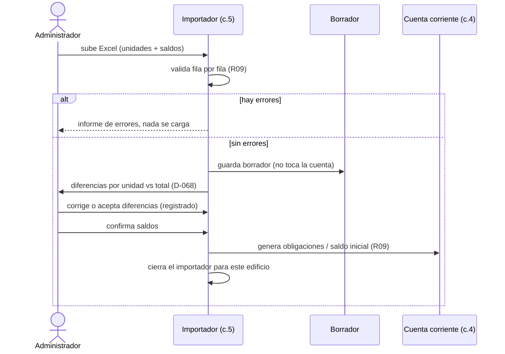
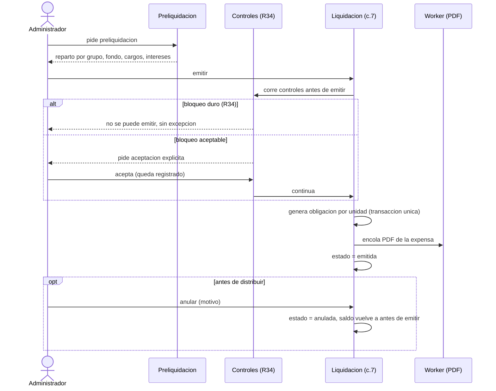

# Flujos Principales

Los flujos centrales del MVP, armados a partir de las historias de `06_funcionalidades.md`, las
reglas de `05_reglas_de_negocio.md` y las fichas de `12_fichas_de_changes.md`. Cada paso cita su HU,
su R o su D. **Ningún flujo describe código que ya corre**: todos corresponden a cambios todavía no
construidos (desde el 3 en adelante); el flujo es el contrato que ese cambio tiene que cumplir, no un
reporte de lo que ya existe. Donde una regla todavía no está validada (propuesta) o una pregunta
abierta condiciona un paso, el flujo lo marca en vez de inventar el comportamiento.

## Flujo 1 · Alta del edificio y carga de la semilla

- **Disparador**: el administrador crea un edificio nuevo en el sistema.
- **Actor**: administrador titular.
- **Cambio**: 3 `configuracion-del-edificio` (HIGH, D-087, D-094).
- **Pasos**:
  1. El administrador crea el edificio; el sistema copia los valores de `config/parametros.yaml`
     (tasa de interés, días de gracia, forma de cálculo, fondo de reserva en 0%, categorías de gasto,
     grupos de reparto típicos, tipos de unidad, estados desactivados) a su configuración (D-042,
     HU-A1).
  2. El administrador carga o ajusta las unidades (a mano o, para el edificio de ejemplo, desde
     `config/semilla/edificio-ejemplo.yaml`, validado contra los parámetros del complejo, D-053).
  3. El administrador define o ajusta los grupos de reparto (R01) y las categorías de gasto (R16),
     y configura intereses (R03) y fondo de reserva (R15) si difieren del default.
  4. Cada cambio de configuración (tasa, fondo) genera una **versión nueva** con fecha y autor; la
     anterior se conserva (D-080). Ninguna liquidación ya emitida se ve afectada por un cambio
     posterior (eso se prueba recién en el cambio 7, que es el que emite).
  5. El sistema fija el **estado de migración** del edificio: pendiente, confirmada o sin saldos
     previos (D-083); el edificio de ejemplo queda "sin saldos previos" porque no trae saldo inicial.
- **Casos de error**:
  - Coeficientes de un grupo que no suman 1 dentro de la tolerancia de ±0,0001 (R01): se rechaza con
    el informe de la diferencia.
  - Una unidad repetida o un tipo de unidad que no existe en los parámetros del complejo: se rechaza
    (`semilla.py`, `_validar_contra_parametros`).
  - Editar la configuración de otro edificio: rechazado por el aislamiento de R10/D-076 (se prueba en
    el cambio 2, que es quien construye el acceso).
- **Pendiente**: si el edificio piloto usa el esquema de doble vencimiento (R26) en vez del
  vencimiento único de R03 (P19, antes del cambio 3); los coeficientes propios de un grupo parcial
  (P24).

## Flujo 2 · Migración de saldos iniciales (importación desde Excel)

- **Disparador**: el administrador sube la planilla del edificio real (unidades y, opcionalmente,
  saldos por período).
- **Actor**: administrador titular.
- **Cambio**: 5 `importacion-desde-excel` (R09, HU-A2). El cambio pide la aprobación escrita de uno de
  los dos socios (D-077, D-094).
- **Pasos**:
  1. El administrador sube el Excel con la hoja principal (piso, departamento, tipo, propietario,
     contacto, coeficiente, saldo inicial, interés ya devengado) y, si el edificio lo tiene, la hoja
     opcional de saldos por período (unidad, concepto, período, vencimiento, monto, interés
     acumulado).
  2. El sistema valida fila por fila; si hay un solo error, no carga nada y entrega el informe
     completo (HU-A2).
  3. Lo importado queda en un **borrador** que todavía no toca la cuenta corriente (D-068).
  4. El sistema compara, **unidad por unidad**, el borrador contra el listado de saldos del
     administrador, y muestra cada diferencia (aunque el total coincida); el total se compara también,
     como control adicional (D-068).
  5. El administrador corrige las diferencias o las acepta igual; aceptar queda registrado (quién,
     cuándo, qué diferencias).
  6. Sin diferencias (o con las aceptadas), el administrador confirma los saldos: el importador genera
     las obligaciones (con detalle por período) o la obligación "saldo inicial" (si vino como total
     único) usando el caso de uso de saldo inicial del cambio 4 (R09), y se **cierra** para ese
     edificio.
  7. Si el edificio no tiene saldos previos (es nuevo, como el de ejemplo), el administrador confirma
     directamente "sin saldos previos", que cierra el importador con todas las unidades en cero
     (D-082); así el control duro de R34 no lo bloquea para siempre.
- **Secuencia**:

- **Casos de error**:
  - Columnas cambiadas de lugar, celdas vacías, números con coma y con punto: rechazo fila por fila.
  - El mismo archivo subido dos veces: el sistema lo detecta y no duplica (D-068).
  - Con el importador ya cerrado, un segundo intento de importar se rechaza; se corrige con un ajuste
    (R08), nunca reabriendo la migración.
  - Dos errores de signo opuesto en dos unidades que dan el total correcto: la comparación por unidad
    igual los muestra como dos diferencias (R09, D-068).
- **Pendiente**: el modo de redondeo (P10) y el cambio de titular a mitad de período (P11), ambos antes
  de este cambio; validar los valores de plata con un administrador o contador (P42).

## Flujo 3 · Carga y aprobación de gastos

- **Disparador**: llega una factura o el administrador necesita cargar un gasto o un cargo particular.
- **Actor**: administrador titular o colaborador con nivel "editar".
- **Cambio**: 6 `gastos-y-cargos` (carga manual, HU-A3, HU-A3b); 14 `lectura-de-facturas` (QR + IA,
  no entra todavía en el cambio 6).
- **Pasos**:
  1. El administrador carga el gasto a mano (proveedor, concepto, categoría, período, importe, grupo
     de reparto, ordinario o extraordinario) o sube la factura electrónica.
  2. Si sube la factura, el sistema lee primero el **QR de ARCA** (monto, CUIT, punto de venta, tipo y
     número) y la IA completa concepto, período, categoría y grupo sugeridos (R12, cambio 14).
  3. El sistema verifica que `cuit + punto_de_venta + tipo + numero` no esté repetido en el complejo
     (R12); si el receptor (`nroDocRec`) no es el CUIT del consorcio, avisa antes de confirmar.
  4. Si la factura no tiene QR legible, el gasto queda **en revisión**, con la nota "sin QR" (D-085);
     si la IA directamente falla, queda **sin IA** (D-075). Ningún dato leído entra en la liquidación
     sin que el administrador lo confirme.
  5. El administrador aprueba el gasto (único momento en que entra al cálculo, D-075) o carga una nota
     de crédito asociada a la factura que corrige (R22, con su monto topeado al de esa factura).
  6. En paralelo, el administrador puede cargar cargos particulares sueltos o importados desde Excel
     (R14), que quedan en borrador hasta aprobarlos.
- **Casos de error**:
  - Gasto sin categoría: no se puede aprobar (R16).
  - Factura cargada dos veces: se frena como duplicada (R12).
  - Nota de crédito que supera el monto de su factura, o sin factura asociada: se rechaza (R22).
  - Un monto leído por IA que se aparta mucho del historial del proveedor en el edificio (propuesta
    R23, umbral pendiente P21, cambio 14): queda marcado para revisión manual antes de aprobar.
- **Pendiente**: qué pasa con un gasto que quedó afuera de un período (sin IA o en revisión aceptada)
  y se aprueba después (P36); dónde se marca un "gasto mensual obligatorio" (P37); si los ingresos del
  consorcio superan los gastos ordinarios de su grupo (P15, R38 propuesta).

## Flujo 4 · Preliquidación y emisión

- **Disparador**: cierra el período y el administrador quiere liquidar.
- **Actor**: administrador titular.
- **Cambio**: 7 `liquidacion-y-emision` (crítico, el de mayor intersección de reglas del MVP).
- **Pasos · preliquidación (sin efectos)**:
  1. El sistema reparte los gastos aprobados del período por grupo de reparto (R01, mayor resto R07),
     neto de notas de crédito e ingresos (R22, R38), más el fondo de reserva (R15); agrega aparte, por
     unidad, los cargos particulares y los intereses (R13, D-079). Nada de esto escribe deuda (HU-A4).
  2. El administrador revisa la preliquidación, desglosada por ordinaria/extraordinaria y categoría.
- **Pasos · emisión (con efectos)**:
  3. El sistema corre los **controles antes de emitir** (R34): saldos iniciales sin validar, factura
     duplicada e ingresos mayores que los gastos son **duros** (no se pueden aceptar, D-080/D-081);
     gastos en revisión bloquean salvo aceptación explícita; gastos sin IA sólo advierten (R24).
  4. Con un bloqueo no duro activo, el administrador puede emitir aceptando la alerta de forma
     explícita; queda registrado quién, cuándo y qué aceptó (R34).
  5. Al emitir: se congelan importes y configuración, se genera una obligación por unidad y período en
     una sola transacción (R13) y se encola el PDF en el worker (el email llega con el cambio 13).
  6. La liquidación pasa a **emitida** (R17); el administrador puede **distribuirla** (acción manual) o
     queda pendiente hasta que un vecino la abra (cambio 11) o salga el primer email (cambio 13), lo
     que ocurra primero (D-074).
  7. Mientras esté **emitida y no distribuida**, el administrador puede **anularla** con motivo: el
     saldo de cada unidad vuelve a quedar igual que antes de emitir (incluidos los ajustes de interés
     que ese interés compensaba), sin borrar ningún movimiento (R17, D-073, D-079, D-085). Un pago ya
     imputado a esa emisión vuelve como crédito a favor, que se imputa en la nueva emisión (D-081).
  8. Después de **distribuida**, ya no se puede anular: todo error se corrige con un ajuste (R08).
- **Secuencia**:

- **Casos de error**:
  - Emitir dos veces el mismo período (sin que la anterior esté anulada): rechazado (R17).
  - El extracto bancario no está procesado o falla el proveedor de IA de facturas: la liquidación sale
    igual, sólo con la advertencia de gastos sin cargar (R24, modo degradado).
  - Intentar anular una liquidación ya distribuida: rechazado.
  - Anular sin motivo: rechazado.
- **Pendiente**: la normativa de Mendoza para una expensa, a investigar antes de cerrar el PDF (D-060);
  con qué fecha se imputa el crédito que vuelve tras una anulación (P38); si el consejo ve una
  liquidación emitida y no distribuida, y si esa vista la distribuye (P39); la bonificación por pronto
  pago después de anular y volver a emitir (P27); si el descuento de la bonificación también achica el
  fondo de reserva (P28); anular un período con el siguiente ya emitido (P26).

## Flujo 5 · Pago informado y confirmación

- **Disparador**: el vecino transfiere y sube el comprobante, o el administrador lo carga por él.
- **Actor**: vecino (sube) y administrador (quién puede confirmar, revertir o reimputar: P23).
- **Cambio**: 8 `pagos-informados` (crítico).
- **Pasos**:
  1. El vecino sube el comprobante (BNA+, Mercado Pago u otro); la IA precarga monto, fecha y número
     de operación, y el vecino los confirma (R11, HU-V4).
  2. El pago queda **informado**, sin efecto sobre la deuda, a la unidad del vecino que lo sube; si
     tiene varias unidades, elige una o reparte el pago entre ellas (R11).
  3. El sistema verifica que el número de operación no esté repetido en el complejo; si lo está, lo
     frena.
  4. El administrador revisa la bandeja de confirmación (con sugerencias de confianza alta por código
     de unidad o CBU histórico, R19, cambio 9) y **confirma** o **rechaza con motivo** (HU-A6).
  5. Al confirmar, el pago se **imputa con R04** (primero el período más antiguo; dentro de él,
     intereses, después ordinaria, después extraordinaria), usando la **fecha de la transferencia**,
     no la de confirmación.
  6. Si hubo una emisión entre la transferencia y la confirmación que ya cobró interés por esos días,
     el sistema registra automáticamente un **ajuste de interés** (crédito enlazado al pago y a esa
     emisión, R11, D-082, D-085).
  7. Un pago que supera la deuda deja el excedente como **crédito a favor**, que se compensa en la
     liquidación siguiente (R05).
  8. Si el banco devuelve el pago después (cheque rechazado, contracargo), el administrador lo marca
     **revertido** con motivo: se registra un contra-movimiento que vuelve a subir la deuda, y la
     unidad puede pasar a cumplir R20 (moroso crítico, R18).
  9. Si el pago se cargó en la unidad equivocada (propuesta R25), el asistente de reimputación genera
     dos movimientos enlazados, en una sola transacción, que restan en la unidad equivocada y suman
     como crédito en la correcta.
- **Casos de error**:
  - El mismo comprobante subido dos veces, o para dos unidades: se frena al subirlo.
  - Doble clic en confirmar: no duplica la imputación.
  - Revertir un pago que no está confirmado: rechazado.
  - Reimputar y que falle a mitad de camino: no queda ningún movimiento aplicado (los dos o ninguno).
- **Pendiente**: la elección del proveedor de IA para leer comprobantes (a decidir en el design);
  interés sobre un pago revertido o reimputado (P29); un número de operación único por banco, no sólo
  por complejo (P40); quién puede confirmar, revertir y reimputar, acción por acción (P23).

## Flujo 6 · Conciliación con el extracto bancario

- **Disparador**: el administrador sube el extracto del banco del período.
- **Actor**: administrador titular o colaborador.
- **Cambio**: 9 `extracto-bancario` (HU-A7).
- **Pasos**:
  1. El administrador sube el extracto (CSV o Excel); un adaptador por banco y formato lo interpreta.
  2. El sistema marca cada pago informado como "coincide" (importe y fecha, más el CUIT de origen
     cuando el banco lo informa) o "no encontrado".
  3. Los movimientos del banco sin comprobante quedan como **fondos pendientes de identificar**.
  4. Un movimiento con el código de unidad en el concepto, o de un CBU que ya pagó esa unidad antes,
     aparece como **sugerencia de confianza alta** en la bandeja de confirmación (R19); el
     administrador siempre confirma con un clic, el sistema nunca asigna solo.
  5. Si al preliquidar o emitir el extracto del período no está completo, el sistema muestra la
     advertencia "extracto incompleto" (R34); no bloquea, porque en el MVP el extracto es una ayuda, no
     el camino de los pagos (D-017).
- **Casos de error**:
  - Formatos de distintos bancos: cada uno con su adaptador.
  - El mismo extracto subido dos veces: no duplica coincidencias.
  - Un movimiento del banco ya usado para confirmar un pago no puede confirmar otro.
- **Pendiente**: qué traen realmente los extractos de los bancos de Mendoza, CBU o sólo el nombre del
  originante (P9, prioridad 0 de Alberto, condiciona si R19 funciona como está pensado); un mismo CBU
  que paga varias unidades de la misma persona, qué unidad se sugiere (P30).

## Flujo 7 · Morosidad: ver quién debe

- **Disparador**: el administrador o el consejo quieren ver el estado de la deuda del edificio.
- **Actor**: administrador titular, colaborador o consejo (sólo lectura).
- **Cambio**: 10a `morosidad` (de sólo lectura, no escribe en la cuenta corriente).
- **Pasos**:
  1. El sistema calcula, para cada unidad, la deuda vencida, la antigüedad de la deuda más vieja y los
     intereses, **siempre desde las imputaciones del libro** (nunca desde una marca de "pagada", R20).
  2. Una unidad con **dos o más liquidaciones vencidas con saldo impago** aparece marcada como
     **moroso crítico** (R20); la función que lo calcula ya existe desde el cambio 4 (D-074): este
     cambio sólo la lista, exporta y presenta.
  3. El administrador exporta el listado a Excel; los números tienen que coincidir con los de la
     pantalla.
- **Casos de error**:
  - Una unidad con una sola liquidación vencida no aparece como moroso crítico.
  - Un pago parcial que no cubre ninguna liquidación completa sigue contando esa liquidación como
    vencida.
  - No hay bloqueo de amenities asociado a esta marca: las reservas de espacios comunes no están en
    el MVP.
- **Pendiente**: si cuenta como vencida una liquidación cuyo saldo es sólo interés, o un saldo por
  debajo del umbral de R30 (P31, umbral también pendiente, P21).

## Flujo 8 · Condonación, gestión judicial y certificado de libre deuda

- **Disparador**: un vecino discute un recargo (condonación); una deuda pasa a manos del abogado
  (gestión judicial); se vende una unidad y hace falta un certificado de deuda.
- **Actor**: administrador titular (ciclo completo).
- **Cambio**: 10b `condonacion-judicial-y-libre-deuda` (propuestas R29 y R31; R21 vigente). El cambio
  pide la aprobación escrita de uno de los dos socios (D-077, D-094).
- **Pasos · condonación (propuesta, R29)**:
  1. El administrador condona un recargo con un motivo obligatorio.
  2. El sistema registra un movimiento de **condonación de interés** (crédito) que neutraliza el
     recargo sin borrarlo; el vecino y el consejo lo ven.
- **Pasos · gestión judicial (propuesta, R31)**:
  3. El administrador marca una unidad como "en gestión judicial": deja de contar como moroso crítico
     (R20) y los avisos automáticos de mora del cambio 13 la saltean.
- **Pasos · certificado de libre deuda (vigente, R21)**:
  4. El administrador pide el certificado de una unidad con una fecha de corte.
  5. El sistema calcula el saldo **desde la cuenta corriente**, nunca lo estima; lista aparte, sin
     restarlos del saldo, los pagos informados todavía no confirmados.
  6. Si la fecha de corte es posterior a un vencimiento, el certificado informa en una línea aparte el
     interés corrido hasta esa fecha (calculado, sin registrarlo en la cuenta corriente, D-081).
  7. El administrador titular lo firma.
- **Casos de error**:
  - Una condonación que borra el recargo original: no es el diseño (nunca se borra).
  - Condonar sin motivo: rechazado.
  - Generar el certificado dos veces para la misma fecha: el saldo no cambia si la cuenta corriente no
    cambió.
  - El certificado nunca incluye una estimación de gastos del período en curso.
- **Pendiente**: quién aprueba una condonación (P20, sin eso R29 no se construye); el plazo para
  entregar el certificado (P14); si el saldo del certificado se calcula por fecha de la transferencia o
  de registro (P32).

## Flujo 9 · Avisos por email

- **Disparador**: una expensa está por vencer, o una unidad entró en mora.
- **Actor**: el sistema (worker), sin intervención del vecino.
- **Cambio**: 13 `avisos-por-email` (HU-V6; depende de 8 y de 10b para la consulta de gestión
  judicial).
- **Pasos**:
  1. El worker detecta una expensa que vence en los próximos días y envía un aviso por email, una sola
     vez, con una **clave de idempotencia** por evento.
  2. Si el vecino ya pagó (pago confirmado) antes del aviso, no lo recibe.
  3. Si la unidad está en mora, el worker envía el aviso de mora, salvo que esté marcada en **gestión
     judicial** (cambio 10b, D-078, propuesta).
  4. Si la fecha del aviso cae en sábado, domingo o feriado, se reprograma al primer día hábil
     siguiente (propuesta R27).
  5. Si el contacto de una unidad tiene un email inválido, o un envío rebota, el administrador ve esa
     unidad en la lista de "unidades sin contacto válido" (propuesta R28); el control homónimo de R34
     lo muestra también antes de emitir.
- **Casos de error**:
  - El worker se cae a mitad del envío: la clave de idempotencia evita un segundo aviso duplicado al
    reintentar.
  - Dos avisos el mismo día a la misma unidad: no debería pasar (una clave por evento).
  - Un aviso de mora a alguien con el pago ya confirmado: no se envía.
- **Pendiente**: avisar mora a un vecino con un pago informado y sin confirmar todavía (P41); el
  proveedor de email (a decidir en el design, sin costo o el más barato, D-043).

## Casos de error transversales

Comunes a varios flujos, no se repiten en cada uno:

- **Modo degradado de emisión** (R24): si falla la IA de facturas o la lectura del extracto, la
  liquidación sale igual; lo que falla queda marcado (sin IA, extracto incompleto) como advertencia,
  nunca como bloqueo duro.
- **Controles antes de emitir** (R34): cada control es bloqueante o advertencia; los bloqueantes no
  duros se pueden emitir aceptando la alerta, con registro; los duros (saldos iniciales sin validar,
  factura duplicada, ingresos mayores que los gastos) no se pueden aceptar nunca.
- **Aislamiento entre administraciones y alcance por edificio** (R10, D-076): se prueba en cada flujo
  que cruza una unidad, un edificio o una administración; se construye una sola vez, en el cambio 2.
